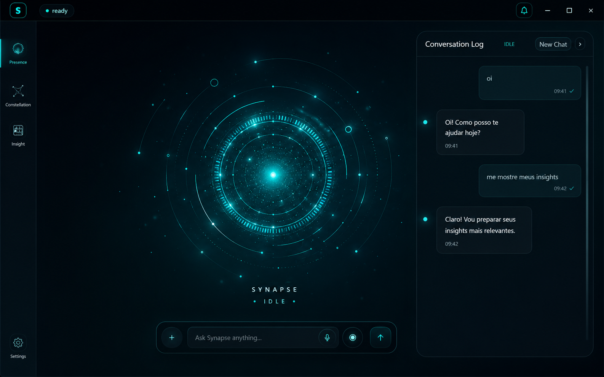
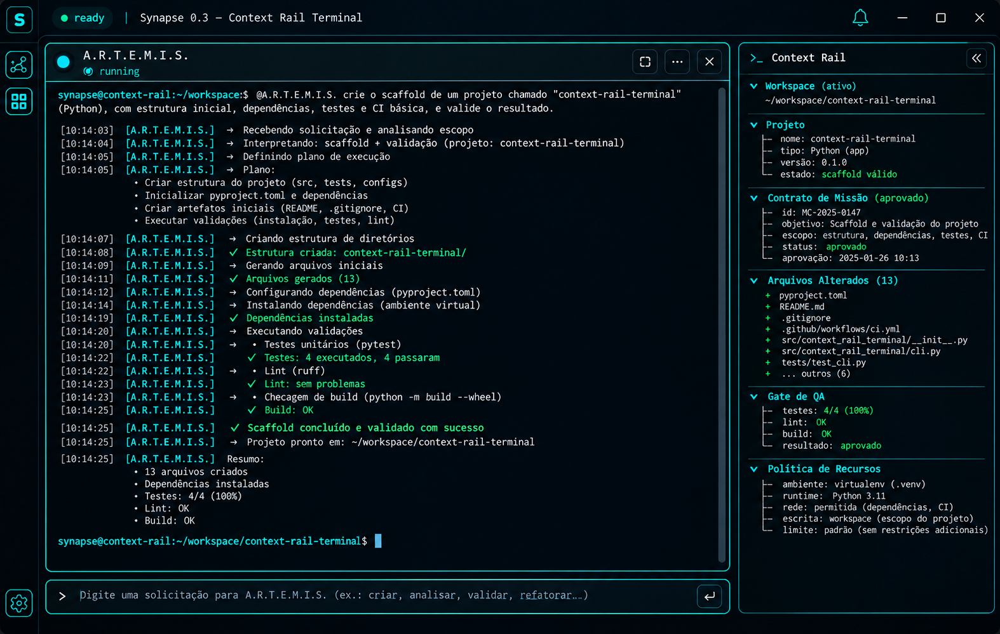
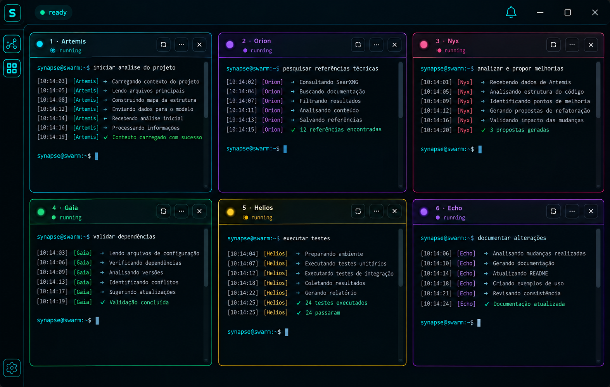

# Synapse 0.3

**A.R.T.E.M.I.S. é um assistente local para conversar e criar projetos.** No
Presence, você poderá conversar por texto ou voz, retomar chats e consultar o
contexto de um projeto quando o mencionar. No Workspace, descreve o que quer
criar, aprova o plano uma vez e acompanha a execução pelo terminal.

O Core em Rust controla a memória, as permissões e as missões. Workers em
Python usam modelos locais para planejar, gerar e revisar o trabalho. As
Skills acrescentam conhecimento de cada área. As ações seguem o escopo
aprovado da missão.

**Estado atual.** O Core já executou pelo CLI uma missão real no Windows com
o Qwen local. A missão gerou arquivos Rust e Python, passou por testes e
revisão separada, publicou os arquivos em um Workspace sem Git e passou pelos
pós-testes. A interface nativa é a próxima entrega visual. [Evidências da missão](docs/evidence/backend/2026-11-11-mission-auto-integration.md)

## Como o Synapse deve ficar

As imagens são referências de design para a interface da 0.3.

### Presence

Assistente de voz e chat. A presença central reage ao microfone e à voz de
A.R.T.E.M.I.S. Na interface planejada, o fundo da conversa é transparente e
as mensagens aparecem em bolhas.



### Workspace

Terminal para planejar e executar projetos. O Context Rail mostra o projeto,
a aprovação, os arquivos e o resultado da revisão. Ao recolher o painel,
o terminal ocupa o espaço disponível.



### Swarm ativo

Grade de terminais para acompanhar os agentes temporários de uma missão.
O Swarm só é iniciado por pedido direto ou após você aceitar uma recomendação
do Planner.



## Progresso da 0.3

O checklist resume os marcos. Cada commit que conclui um marco atualiza a
marcação e vincula a evidência do teste. Os critérios de aceite e as tarefas
de cada etapa estão no [roteiro até a finalização](docs/superpowers/plans/2026-11-11-synapse-0.3-roteiro-de-automacao.md).

### Etapas concluídas

- [x] **01. Reconstrução da 0.3 consolidada.** [Evidência](docs/evidence/backend/2026-11-10-workspace-consolidation.md)
- [x] **02. Core Rust, contratos e worker Python integrados.** [Evidência](docs/evidence/backend/2026-11-09-integration.md)
- [x] **03. Conversa local por texto e histórico pelo Core.** [Evidência](docs/evidence/backend/2026-11-10-contextual-conversation.md)
- [x] **04. Memória canônica versionada com aprendizagem automática e consulta por referência.** [Evidência](docs/evidence/backend/2026-11-10-automatic-memory.md)
- [x] **05. Orientação por uma versão fixada de Skill no Core.** [Evidência](docs/evidence/backend/2026-11-10-skill-guidance.md)
- [x] **06. Planejamento de missão e aprovação de escopo selado.** [Evidência](docs/evidence/backend/2026-11-10-mission-planning.md)
- [x] **07. Testes isolados de Rust e Python pelo CLI no Windows.** [Evidência](docs/evidence/backend/2026-11-11-core-project-check-lifecycle.md)
- [x] **08. Geração, pré-testes e revisão separada do candidato.** [Evidência](docs/evidence/backend/2026-11-11-mission-candidate-review.md)
- [x] **09. Publicação automática, pós-testes e reversão verificada para arquivos novos em Workspace Windows sem Git.** [Evidência](docs/evidence/backend/2026-11-11-mission-auto-integration.md)

### Etapas a seguir

- [ ] **10. Recuperação de missões interrompidas.** Inspecionar e resolver `recovery_required` pelo CLI.
- [ ] **11. Aplicativo Rust nativo.** Ligar Presence textual e Workspace ao Core, incluindo aprovação, progresso e recuperação.
- [ ] **12. Workspace ampliado.** Integrar projetos Git, ferramentas e outros tipos de projeto com verificações próprias.
- [ ] **13. Voz e tradução.** Ativar por “Artemis”, responder com voz fixa, animar com áudio real e traduzir nos dois sentidos.
- [ ] **14. Navegador interno.** Usar sessões autenticadas e executar ações autorizadas pela missão.
- [ ] **15. Evolução de Skills, MoM e Swarm.** Validar promoção de Skills, orquestração local de modelos e agentes temporários sob aceite.
- [ ] **16. Distribuição e aceite final da 0.3.** Validar instalação, atualização e fluxos reais no Windows. Preparar builds de Linux e macOS e registrar o estado de validação de cada plataforma.

Depois da 0.3, o roteiro prevê hospedar o mesmo Core em um servidor pessoal e
acessá-lo por clientes desktop e móvel.

## Desenvolvimento

O código do produto usa Rust e Python. A branch `0.2` serve como referência
histórica. Para rodar a suíte padrão do Core no Windows com Rust e Python 3.14
instalados:

```powershell
cargo test -p synapse-core --locked
```

A interface do CLI usa uma solicitação JSON por linha. A configuração dos
runtimes e os comandos estão na [referência do protocolo v1](backend/contracts/v1/README.md).

- [Documento de decisões](docs/specs/2026-11-06-synapse-0.3-decision-charter.md)
- [Arquitetura da 0.3](docs/specs/2026-11-06-synapse-0.3-clean-room-design.md)
- [Roteiro detalhado](docs/superpowers/plans/2026-11-11-synapse-0.3-roteiro-de-automacao.md)
