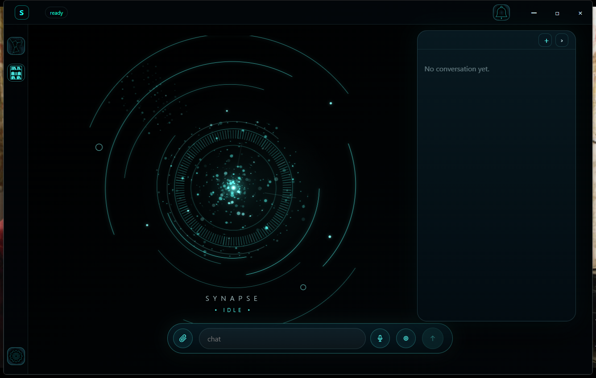

# Synapse

Synapse is a local-first desktop environment for personal AI agents. The current
v0.01 line focuses on the working Electron shell, local backend sidecar,
conversation flow, history, theme-aware interface, and the Presence visual layer.



## Current product surface

- Electron desktop app with a local backend sidecar.
- Conversation Log with chat-style user and assistant bubbles.
- Local chat routing through configured model providers such as LM Studio.
- Conversation history with persisted deletion controls.
- Theme-aware navigation/status icons for Synapse, Violet, Amber, Blue, and
  Neutral.
- Presence orb rendered procedurally in the frontend, with theme-aware ambient
  lighting, particles, rings, and pulse states.

The left sidebar, top status badge, composer, and Conversation Log are part of
the current v0.01 shell. The Presence/Constellation area is intentionally visual
first in this version; full swarm activity projection remains a later runtime
target.

## Swarm constellation target

The image below is a concept reference for how the central constellation should
evolve when a real swarm is active. It is not a screenshot of the current
runtime. It shows the intended direction: a primary agent coordinating model,
tool, memory, planning, verification, and repository participants through a
living activity graph.


## Repository layout

```text
apps/frontend-v2/        Electron + React desktop shell
backend/synapse/         Python backend runtime domains
data/                    Development seed data and local defaults
docs/                    Architecture, roadmap, validation, and product notes
scripts/                 Operational build and validation scripts
tests/                   Backend and architecture tests
```

## Development setup

Prerequisites:

- Python 3.12+
- `uv`
- Node.js/npm

Backend:

```powershell
uv sync --extra dev
uv run uvicorn synapse.main:app --app-dir backend --host 127.0.0.1 --port 8717
```

Frontend:

```powershell
cd apps/frontend-v2
npm install
npm run build
```

Desktop runtime:

```powershell
cd apps/frontend-v2
npm run electron:dev
```

## Validation

Use focused gates for the area being changed before broad validation. Common
checks used during v0.01 stabilization:

```powershell
uv run --extra dev pytest tests/test_frontend_v2_boundary.py
cd apps/frontend-v2
npm test
npm run build
```

## Engineering rules

- Backend contracts remain authoritative for persistence and runtime authority.
- UI code must not bypass policy, approval, or provider boundaries.
- Runtime caches, installed-app state, receipts, and generated test data are not
  product source.
- Stale runnable bundles should be retired or ignored so the app cannot open an
  old renderer by accident.
- The active workspace for current v0.01 work is `F:\Projetos\Synapse`.
