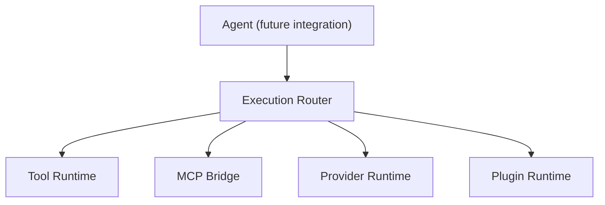

# ADR 0089: Execution Router Runtime

## Status

Accepted.

## Context

Synapse now catalogs internal tools, tool intents, MCP references, providers, and provider plugins. Future callers need one routing abstraction rather than direct knowledge of every execution ecosystem. Routing must be defined before execution is enabled.

## Decision

Add `ExecutionRouterRuntime` and `ExecutionTargetRegistry` under `backend/synapse/execution_router/`.

The registry contains structural targets for Tool Runtime, MCP Bridge, Provider Runtime, and Plugin Runtime. The router validates a tool, intent, MCP bridge reference, or provider and returns an immutable `ExecutionPlan` containing the selected target, descriptive fallbacks, routing reason, request id, and timestamp.

Availability describes whether a selected destination is currently operationally eligible. A plan may identify an unavailable MCP/provider destination without executing or silently replacing it.

The routing table is generated in memory and has no persistent state. Agent Runtime is not changed and does not consume the router in this stage.

## Architecture

These are parallel routing targets, not an execution chain.

## Interfaces

Commands: `/execution-targets`, `/execution-plan <tool_id>`, and `/execution-summary`.

API: `GET /execution/targets`, `POST /execution/plan`, and `GET /execution/summary`.

## Consequences

Execution mechanisms can evolve behind one planning boundary. No target method, tool handler, MCP transport, provider action, plugin entrypoint, model, or agent is executed by this runtime.

No automatic Tool Calling, planner, workflow, LLM integration, MCP connection, or new UI is introduced.
