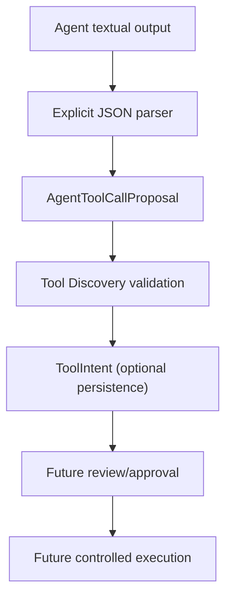

# ADR 0090: Agent Tool Calling Bridge

## Status

Accepted.

## Context

Synapse can discover tools, persist reviewed tool intents, and produce execution plans. Agent/model text still needs a deterministic, non-executing bridge into Tool Intent Runtime before provider-native function calling or controlled intent execution can be considered.

## Decision

Add `AgentToolCallingRuntime` under `backend/synapse/agent_tool_calling/`.

The bridge accepts only explicit JSON containing `synapse_tool_intent`, either as a complete JSON value or inside a fenced JSON block. The value may contain one proposal or a list. It never infers tools from natural language and never invokes an LLM to parse output.

Each proposal is checked against the agent's Tool Discovery catalog. Preview attaches the discovery view and Execution Router plan without persistence. Create mode delegates persistence to Tool Intent Runtime and stores the plan as metadata. Unavailable or unknown tools are skipped with explicit errors.

Agent Runtime receives the bridge as an optional injected dependency. `config/agent_tool_calling_policy.yaml` defaults to:

```yaml
enabled: false
mode: preview
```

Modes are `disabled`, `preview`, and `create_intent`. Even create mode only creates a ToolIntent. It never executes a tool, creates an operational approval, or applies approval.

## Flow



## Interfaces

Commands: `/tool-call-preview <agent_id> "<text>"` and `/tool-call-create <agent_id> "<text>"`.

API: `POST /agents/{agent_id}/tool-call/preview` and `POST /agents/{agent_id}/tool-call/create`.

## Consequences

Structured model output can become a durable proposal without granting execution authority. Chat messages expose the bridge result as metadata while preserving response text.

No native LM Studio/OpenAI function calling, MCP execution, automatic approval, tool execution, planner, workflow, or new UI is introduced.
