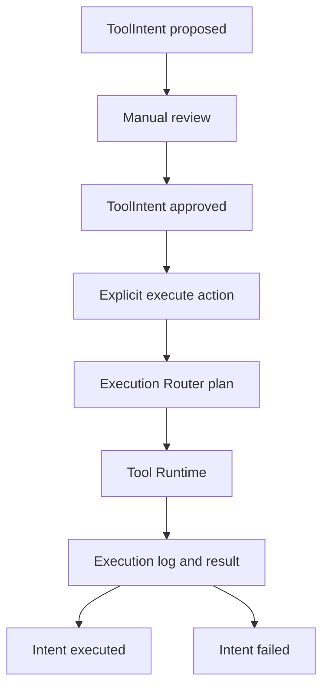

# ADR 0091: Tool Intent Execution Flow

## Status

Accepted.

## Context

Tool intents can be proposed and manually reviewed, while Tool Runtime can execute explicit requests through permission and approval controls. A manual bridge is required to execute an already approved intent without granting execution authority to agents or models.

## Decision

Expand `ToolIntentRuntime` with `can_execute_intent()`, `execute_intent()`, and `execution_summary()`.

Only status `approved` is executable. Proposed, reviewed, rejected, cancelled, executed, and failed intents are rejected before Tool Runtime is called. Execution is initiated only through the explicit runtime method, command, or API endpoint.

Before execution, Tool Intent Runtime asks Execution Router for a plan. It then creates `ToolExecutionRequest` from the persisted tool id, arguments, agent/conversation/mission references, and correlation fields. Tool Runtime remains the sole execution owner and continues to enforce Permission Bridge and Approval Runtime.

The intent YAML records the execution plan, summarized ToolExecutionResult, execution timestamp, executor, and terminal status. Successful execution becomes `executed`. Any routing error, missing tool, permission block, approval-required result, or handler failure becomes terminal `failed` in v1. No retry or automatic resume exists.

Intent approval remains distinct from operational tool approval. An approved intent for an approval-required tool can still be denied or produce a pending operational ApprovalRequest when explicit execution is attempted.

## Flow

## Interfaces

Commands: `/execute-tool-intent <intent_id>` and `/tool-intent-execution <intent_id>`.

API: `POST /tool-intents/{intent_id}/execute` and `GET /tool-intents/{intent_id}/execution`.

## Consequences

Synapse supports the complete manual lifecycle: discovery, proposal, review, explicit execution, and durable result. Execution remains fail-closed and non-repeatable.

No automatic execution after review/approval, agent autonomy, native function calling, MCP execution, retry, planner, workflow, dangerous real tool, or new UI is introduced.
