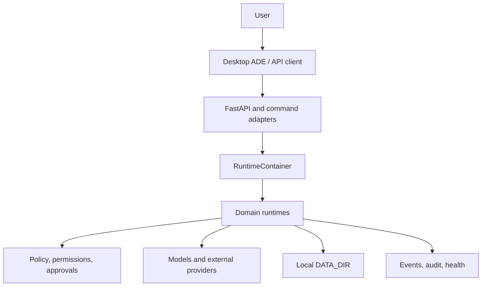

# Synapse V3 Architecture

Intelligence Trust Boundary is an independent bounded context outside the
global SCC. Model Router and Tool Runtime consume neutral gate contracts;
external MCP inherits Tool gating and bootstrap owns Storage/Health wiring.
The graph is 72 contexts / 261 edges while the global SCC remains 13/35 and
the exact module graph remains acyclic.

Project Governance + RFC is an independent bounded context outside the global
SCC. Context, Missions and Skills consume neutral ports; Storage, documents,
Tool execution and Health are bound only by bootstrap. The governed graph is
71 contexts / 257 edges with the global SCC unchanged at 13/35.

Skills Runtime Phase 1 is an independent bounded context outside the global
SCC. Consumers import only neutral contracts; storage/tool adapters and all
wiring live in bootstrap. See `docs/architecture/skills-runtime.md`.

## Agent kinds and continuous primary interaction (2026-07-14)

The backend has exactly three explicit kinds: Primary, persistent and ephemeral.
Provisioning remains the durable creation authority; Mission/Swarm is the only
entry to ephemeral creation. Primary references a persistent identity and main
conversation and returns a frontend-neutral bootstrap without side effects. The
legacy Agent Creator was removed. See `architecture/agent-kinds.md`,
`architecture/primary-agent.md`, and `architecture/ephemeral-agents.md`.

## Operational storage primitives (2026-07-14)

Small operational collections now share neutral atomic write, collection locking,
revision/schema contracts, deterministic pagination, recovery and retention. Four
controlled pilots adopted the boundary; human-editable content and growing SQLite
candidates remain unchanged. See `architecture/storage-primitives.md` and
`architecture/storage-strategy.md`. The backend remains NOT READY.

## Canonical provider taxonomy (2026-07-14)

Provider identity and discovery now use one neutral, discovery-only
`ProviderCatalog`, populated by explicit bootstrap projections. Model, Speech,
Vision, Capture, Desktop, Insight and Notification execution remains in specialized
domain ports/registries. Availability is separate from Health and Readiness; public
surfaces are frozen. See `architecture/provider-taxonomy.md`. This does not mark the
backend READY.

## Health contributor boundary (2026-07-14)

Health is inverted through one ordered registry and ten explicitly registered
bounded-context contributors. `health/runtime.py` is a neutral collector with
timeout and failure isolation; Readiness consumes only the canonical health
snapshot protocol. The 32 component IDs, 82 summary fields and public API are
equivalent. See `docs/architecture/health-contributors.md` and the Health
contributors validation report.

## API bounded-context boundary (2026-07-14)

The 471 HTTP operations are owned by 13 bounded-context routers registered once
in `synapse.api.router_registry`. `api/routes.py` is compatibility-only. Routers
resolve the lifespan-owned container and call canonical facades; AST guardrails
block stores, concrete providers, bootstrap dependencies, runtime construction,
DataDir access, duplicate registration and duplicate operation IDs. The complete
OpenAPI contract remains structurally identical. See
`docs/architecture/api-routing.md` and the API decomposition validation report.

## Command bounded-context boundary (2026-07-14)

The 363 slash-command names are resolved by one canonical registry and owned by
14 bounded-context handlers. `commands/runtime.py` is now a compatibility
facade/dispatcher; bootstrap registers handlers explicitly. The frozen 339
branch/24 alias surface is equivalent, while AST rules block store, DataDir,
provider, API and bootstrap coupling in handlers. See
`docs/architecture/command-runtime.md` and the command decomposition report.

The backend remains **NOT READY**.

## Phase 1 composition boundary (2026-07-14)

Backend construction is owned by `synapse.bootstrap.application`, which
coordinates nine feature builders and creates one `RuntimeContainer`. FastAPI
lifespan owns construction/start/shutdown; `synapse.core.app` and
`synapse.core.model_router` are compatibility adapters. AST rules prevent new
reverse dependencies and cycle growth. See `docs/architecture/bootstrap.md`,
`dependency-rules.md`, `lifecycle.md`, and the Phase 1 validation report.

This stabilization does not mark the architecture READY: three SCCs and other
Phase 2 blockers remain, although Health no longer belongs to the largest SCC.

## Desktop Automation + Application Control Boundary

Desktop Automation is the generic governed execution plane for applications,
windows, accessibility elements, fallback input, transient visual evidence, and
mandatory verification. `DesktopRuntime` orchestrates separate runtimes but
performs no OS action itself. Native Windows UI Automation, Linux AT-SPI, and
macOS Accessibility providers precede OCR, Vision, and element-relative input.
Policy, Approval, Audit, Redaction, Vision, Perception, Insight, Mission, and
Agent Loop are consumed only through their existing public ports. See
`docs/backend/desktop-runtime.md`.

## Insight + System Runtime Boundary

Insight is the read-only operational-awareness plane. Separate System, Hardware,
Disk, Process, Model Capability, Resource Pressure, and Diagnostics runtimes
consume isolated Windows/Linux/macOS providers. Agent Loop sees the composed
Insight facade, Mission sees only Resource Pressure, and Model Router sees only
Model Capability. No other runtime imports an OS probe or `psutil`. Optional
resources never become readiness requirements. See `docs/backend/insight.md`.

## Platform Governance Boundary

`EffectivePolicyRuntime`, `EventBus`, `HealthRuntime`, and `ReadinessRuntime`
form the transverse governance plane. Functional domains retain ownership of
their state and publish compatible policy decisions, correlation IDs, telemetry
and health snapshots. Governance aggregates those contracts without becoming a
second implementation of Agents, Tools, Missions, Models, Memory, or Voice.

## Voice Domain Boundary

Voice orchestrates separate Audio, Device, Speech Provider, VAD, persistence,
ChatRuntime, and Perception-port boundaries. Conversation Mode calls only
`ChatRuntime.submit_turn`; Perception integration uses an optional neutral sink.

This document is the normative system architecture for Synapse V3. ADRs record
why individual decisions were made; this specification defines how current and
future components fit together.

## Status Model

- **Implemented**: executable code exists and has direct test coverage.
- **In development**: code exists but is incomplete or still under backend
  stabilization.
- **Planned**: approved target with no complete implementation.
- **Legacy**: retained implementation that is not the V3 target.

## Architectural Intent

Synapse is a local-first agent operating environment. The backend owns durable
state and authority. Clients render state and submit commands but cannot own
permissions, approvals, model policy, tool execution, or workflow transitions.

Core properties:

- modular domain runtimes with explicit inputs and outputs;
- local data ownership through `DATA_DIR`;
- replaceable model and external-service providers;
- policy, permission, and approval checks before side effects;
- event and audit records for operational traceability;
- deterministic tests through explicit adapters and fixtures;
- a desktop ADE as the primary planned product surface.

## System Context



The FastAPI process is not a stateless web application. It hosts a runtime
container whose services coordinate local persistence and providers.

## Runtime Layers

### 1. Adapters

Status: **Implemented**, with some contracts still unstable.

- FastAPI routes under `backend/synapse/api/`.
- Slash commands in `CommandRuntime`.
- Scheduler jobs and daemon cycles.
- Provider adapters for models, speech, vision, and other external boundaries.

Adapters translate transport data into domain calls. They must not implement
domain policy.

### 2. Application Domains

Status varies by domain.

- agents, identity, custom provisioning, administration;
- chat and conversations;
- delegation, execution, retry, timeout, recovery, dead letter;
- missions and mission control;
- tasks, scheduler, lifecycle, presence, notifications;
- agent-to-agent communication and notifications;
- models, model hub, providers;
- tools, tool intents, MCP, execution router;
- audio, voice, vision, perception and context fusion.

Frontend owns visualization and animation. Voice owns factual voice states and
events. Perception owns multimodal observations, features and inferences. No
Avatar or Embodiment Runtime exists in the target architecture.

Each runtime owns state transitions and emits domain events. Cross-domain calls
must use runtime interfaces rather than reading another domain's files.

### 3. Authority

Status: **Implemented foundation**, **In development** for complete coverage.

- `PermissionManager` checks actor permissions and resource scope.
- `AgentEffectivePolicyRuntime` composes global and agent policy.
- `ApprovalManager` persists and transitions human approval requests.
- provisioning, admin, tool, and other policy runtimes classify
  risk before side effects.

Order of enforcement:

```text
validate input
resolve identity and context
resolve capability and policy
check permissions/resource scope
require or validate approval
perform side effect
persist result
emit event and audit
```

### 4. Persistence

Status: **Implemented**, with migration coverage still expanding.

`DataDir` resolves every operational path below a configurable root. Formats
are selected by use case:

- YAML or JSON for structured records;
- Markdown for human-editable identity and memory files;
- JSONL for append-only events and audit timelines;
- binary files for audio, models, thumbnails, and future media assets.

No domain may rely on an absolute developer path. New records require:

- `schema_version` where schema evolution is expected;
- stable record identifiers;
- timestamps in ISO 8601 UTC format;
- atomic write or rollback strategy for multi-file state;
- migration or explicit compatibility behavior.

See [Backend](backend.md) and [Security](security.md).

### 5. Providers

Status: **In development**.

Providers isolate external systems from domain logic. A provider contract must
define configuration, health, timeout, error mapping, capability discovery,
and secret handling. Mock providers are test adapters and cannot be presented
as production capability.

## Runtime Container

`backend/synapse/core/app.py` constructs the dependency graph. It is the
composition root and may wire concrete runtimes, but it should not contain
business rules.

Target constraints:

- one initialized service instance per runtime container;
- explicit dependencies passed to constructors;
- no module-level mutable singleton state;
- deterministic temporary `DATA_DIR` support for tests;
- startup validation of required policy and migration state;
- health/readiness summaries derived from runtime status, not hardcoded flags.

## Principal Flows

### Agent Message

```text
client -> chat/conversation adapter -> ContextFusionRuntime
       -> authorized memory/history/mission/perception selection
       -> ContextLoader compatibility adapter for identity/effective policy
       -> AgentRuntime -> model adapter
       -> optional tool intent / approval / execution
       -> persisted message and events
```

Status: **Implemented / Frozen**. Conversation and Chat share a canonical turn
service, durable message model, bounded context preparation, provider-neutral
generation, tool metadata, real model summaries, attachment validation,
streaming lifecycle events, cancellation, and structured errors. The focused
suite has 97 passing tests and the global suite has no failures in this domain.

### Delegated Work

```text
requester -> delegation policy -> task
          -> scheduling / inbox -> worker
          -> execution -> completion or failure
          -> retry / timeout / recovery / dead letter
```

Status: **Implemented and stabilized** at the domain-test level.

### Agent Provisioning

```text
explicit user or authorized programmatic request
  -> request validation
  -> risk policy
  -> optional approval
  -> dry-run OR staging write
  -> Registry + Identity validation
  -> atomic commit / rollback
  -> admin initialization
  -> events and audit
```

Status: **In development** in the local working tree. Documentation describes
the target contract; do not infer release readiness from local tests alone.

### Multimodal Context

```text
audio/vision/provider signal -> perception -> context fusion

Perception is now split into four bounded layers: Capture owns authorization and
visual lifecycle; Vision owns provider execution; Perception owns canonical
validation, persistence, deduplication, expiry, and observations; Multimodal
owns temporal correlation. Context Fusion is a downstream consumer of active
observations and provenance. None of these layers implements World State or an
agent action loop.
                             -> agent context bridge -> AgentRuntime
```

Status: **In development**. Contracts and several runtimes exist; real provider
coverage and global integration remain incomplete.

## Agent Boundary

An agent is identified by its canonical folder under `agents/{agent_id}`.
`CONFIG.yaml` contains structured configuration; `SOUL.md` and `SKILLS.md`
provide human-readable identity material. Registry lookup accepts compatible
partial configs, while operational identity loading enforces required fields.

Agents do not gain authority from role names. Capabilities, permissions,
policy, and approval determine authority. `can_delegate` defaults to false.

See [Agents](agents.md).

## Memory And Context Boundary

Memory is durable knowledge, not chat history and not arbitrary prompt text.
`MemoryStore` provides scoped persistence through `MemoryStorage`.
`ContextFusionRuntime` is canonical and applies authorization, priority,
deterministic budget estimates, deduplication, provenance, and omission tracking.
It consumes only small consumer-owned read ports wired by bootstrap; concrete
source runtimes do not cross this boundary. See
[Context Fusion ports](architecture/context-fusion-ports.md).
`ContextLoader` remains a compatibility adapter for agent identity/policy DTOs.

See [Memory](memory.md).

## Model Boundary

## Tool Execution Boundary

Agents, Conversation, commands and API submit untrusted tool intents to ToolRuntime.
Registry lookup, schema validation, permission/risk decision, preview, approval,
execution and audit precede results. MCP is an adapter behind the same boundary.

Product runtimes call `ModelRouter`, which resolves an explicit `ModelSelection`
and invokes the canonical provider adapter. LM Studio, Ollama and OpenAI-compatible
transport details do not cross this boundary. Model Hub owns discovery/catalog;
ProviderSettings owns endpoints and secrets; capability registries describe support
but never execute generation.

Domains request model capabilities through routing/provider contracts. They do
not call LM Studio, Ollama, OpenAI-compatible servers, or cloud SDKs directly.
Provider identifiers and model identifiers remain distinct. Secret material is
never written to events or ordinary config records.

See [Models](models.md).

## Frontend Target

Status: **Not implemented**.

ADR 0119 retires the old Electron ADE implementation. No desktop client, package target
or frontend source tree is active in the repository.

The abandoned `frontend/` React application, `desktop/` Tauri shell and removed Electron
ADE are historical only. No active frontend or backend-owned visual layout contract
exists. A future frontend must consume ordinary domain APIs and keep presentation state
outside backend authority.

See [Frontend](frontend.md).

## Swarm Target

Status: **Planned**.

Swarm is coordinated multi-agent execution, not unrestricted agent spawning.
It depends on stabilized identity, provisioning, delegation,
capability policy, bounded memory/context, scheduling, recovery, and audit.
No swarm controller should be implemented by bypassing those runtimes.

See [Swarm](swarm.md).

## API Contract Strategy

- Domain objects are serialized through explicit DTOs or dataclasses.
- Validation failures map to 422; missing resources to 404; permission failures
  to 403; unexpected exceptions do not expose internals.
- Long-running or approval-gated operations return durable request IDs.
- Commands and HTTP endpoints call the same runtime methods.
- OpenAPI is generated by FastAPI but is not sufficient documentation by
  itself.

See [API](api.md).

## Observability

Events carry identifiers, timestamps, actor, correlation, causation, parent,
source, and structured payload where available. Audit answers who requested or
authorized a durable state change. Health describes runtime state; readiness
describes whether a capability is safe to accept work.

Target rule: logs may aid diagnosis but are not a substitute for events,
audits, or durable status records.

## Security Boundaries

- future renderer processes are untrusted relative to desktop main and backend;
- provider responses are untrusted input;
- model output cannot directly authorize tools;
- file paths remain within approved resource scopes;
- approvals bind actor, operation, arguments, risk, and target;
- secrets use protected storage and are redacted from telemetry;
- plugins and MCP servers receive explicit capabilities, never ambient access.

See [Security](security.md).

## Evolution Rules

1. Stabilize one backend domain before moving to another.
2. Add a contract before adding a transport surface.
3. Add migrations before changing durable schemas.
4. Keep planned and implemented states visibly separate.
5. Preserve local-first operation; network use is explicit and policy-bound.
6. Do not move business logic into API routes, commands, desktop main, or UI.
7. Use ADRs for decisions that alter these boundaries.

## Continuous agent operating layer

World State, Attention, disposition selection, and execution coordination are
separate ownership boundaries. Frozen domains emit events and remain their own
sources of truth. The operating layer projects bounded references, filters
noise, consults governance, and routes authorized work back through canonical
Chat, Tool, Mission, Approval, Notification, Observability, and Memory
contracts. Scheduler and Daemon host bounded one-shot cycles; there is no
parallel daemon or unrestricted autonomy controller.

## Canonical Tool Execution Boundary

All tool discovery and execution converges on one `RuntimeToolRegistry` and one
`ToolRuntime`. Builtin, MCP, and Desktop operations are technology adapters behind
that boundary; consumers depend on `ToolExecutionPort` and stable identities rather
than adapter classes. The boundary owns schema validation, governance, preview,
timeout/cancellation, idempotency, redacted history, verification, and canonical
results. See [Canonical Tool Execution Boundary](architecture/tool-execution-boundary.md).
# Administrative DataDir maintenance

Administrative DataDir behavior is bounded by a neutral
`DataMaintenanceRuntime`, one explicit contributor registry and owner-provided
inspection/cleanup implementations. API and Commands accept registered scopes,
not paths, and every destructive action originates in a durable checksummed,
revisioned and expiring plan with confirmation, policy and conditional approval.
The runtime never interprets domain records or resumes cleanup automatically.
Global backup/restore is unavailable. The backend remains **NOT READY**; see
`architecture/data-maintenance.md` and the phase validation report.
