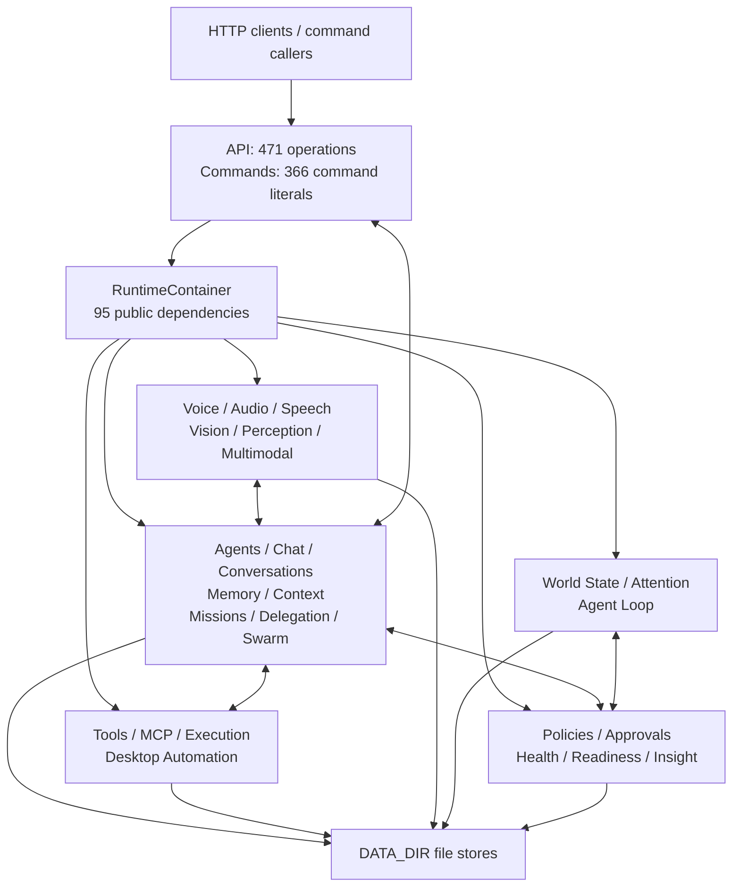

# Synapse Backend Architecture Review

Intelligence Trust Boundary adds one singleton/DAG bounded context and four
governed edges (`api`, `commands`, `models`, `tools` to
`intelligence_boundary`). It remains outside the unchanged global SCC of 13
contexts / 35 internal edges; the exact module graph remains acyclic. Runtime
consumers import contracts/models only and bootstrap owns Storage and Health.

Project Governance + RFC adds one singleton/DAG bounded context and five
governed consumer/delivery edges. It remains outside the unchanged global SCC
of 13 contexts / 35 internal edges; the exact module graph remains acyclic.
Documents and Storage/Tool adapters are bound by bootstrap, while consumers
import contracts/models only.

Skills Phase 1 adds the `skills` singleton/DAG without changing the only
pre-existing SCC (13 contexts / 35 internal edges). New governed edges are
delivery/consumer-to-contract edges plus `skills -> core`; bootstrap edges are
excluded from governance.

## Addendum — Primary, persistent and ephemeral agents (2026-07-14)

O backend agora possui exatamente três categorias explícitas. Provisioning continua
como única autoridade persistente; Primary mantém apenas vínculo e conversa;
Mission/Swarm governa identidades efêmeras limitadas por recursos, policy, lease e
cleanup. O adapter Agent Creator, seus DTOs paralelos e facts de Health/Readiness
foram removidos. DataDir e ciclos não relacionados não foram atacados. O backend
permanece **NOT READY**.

## Addendum — primitives de Storage operacional (2026-07-14)

O inventário consolidou 48 famílias e introduziu uma primitive neutra apenas para
quatro pilotos de baixo risco. Conteúdo humano permaneceu fora; históricos
crescentes foram classificados como candidatos futuros a SQLite com base em
medição de 100/500 agentes. DataDir não foi redesenhado e os SCCs não relacionados
não foram atacados. Agent Creator, manutenção do DataDir, ciclos remanescentes e a
auditoria final continuam abertos; backend **NOT READY**.

## Addendum — taxonomia geral de Providers (2026-07-14)

A identidade transversal foi consolidada em um manifest neutro e um catálogo
somente de discovery, com projeções explícitas no bootstrap. Registries e contratos
especializados continuam autoridades de execução. Mocks não entram no catálogo de
produção e só podem ser resolvidos em modo de teste/desenvolvimento explícito. Os
SCCs permanecem 25/76, 4/6 e 2/2; não há alegação de redução. A adoção ampla de Storage, Agent Creator,
DataDir e a auditoria final seguem abertos, portanto o backend permanece **NOT
READY**.

Data da auditoria: 2026-07-14
Escopo: backend Python no working tree local
Fora do escopo: segurança, pentest, frontend, Electron e Client SDK

## Resumo executivo

Resposta objetiva: **não**. A arquitetura atual possui uma base funcional ampla,
bons conceitos de domínio e vários pontos de extensão úteis, mas ainda não está
consistentemente modular nem preparada para evoluir por anos sem uma etapa de
consolidação arquitetural.

O backend contém 64 pacotes de primeiro nível, 320 arquivos Python e cerca de
59 mil linhas. A separação nominal em runtimes, models, registries, providers e
eventos é um ponto forte. A implementação real, porém, converge para um grafo
fortemente conectado: ao incluir o composition root, 61 dos 64 pacotes de
primeiro nível participam de um único componente fortemente conectado; `api`,
`contracts` e `observability` ficam fora dessa componente. Mesmo retirando
`core/app.py` da análise, permanecem ciclos diretos entre domínios e uma grande
componente cíclica causada por imports concretos, agregadores transversais e
adapters que conhecem quase todo o sistema.

Os maiores centros de gravidade são:

- `RuntimeContainer`, com 95 dependências públicas;
- `create_runtime`, com 665 linhas e 136 chamadas de construção;
- `CommandRuntime`, com 67 dependências, 329 métodos e 5.951 linhas;
- `api/routes.py` e routers, com aproximadamente 6.949 linhas, 471 operações e
  modelos de transporte definidos junto das rotas;
- `HealthRuntime`, com dependências diretas sobre 36 pacotes;
- persistência file-backed distribuída, com convenções semelhantes, mas sem uma
  abstração transacional ou de coleção comum.

O estado final desta revisão é **NOT READY**. Isso não significa que o backend
não funcione: a suíte atual passou com `972 passed` e `4 subtests passed`. Significa
que a estrutura não oferece isolamento suficiente para crescimento sustentado,
especialmente para novos runtimes, mudanças transversais e escala de centenas de
agentes.

## Método e evidências

A revisão foi feita sobre o código atual, não apenas sobre documentação:

- inventário de todos os pacotes sob `backend/synapse`;
- análise AST de imports entre pacotes e componentes fortemente conectados;
- inspeção de `RuntimeContainer`, `create_runtime`, adapters HTTP e commands;
- busca de classes sem referência interna, providers, registries, stores,
  persistência e eventos;
- comparação com README, arquitetura, module status, roadmap, ADRs e relatórios
  de validação;
- geração e inspeção do OpenAPI atual;
- execução de `uv run --extra dev pytest -q`: `972 passed`, `4 subtests passed`,
  em 520,75 segundos.

Métricas de fan-in/fan-out são contagens de pacotes distintos importadores e
importados. Elas indicam pressão arquitetural, não qualidade isoladamente.

## Mapa arquitetural

O desenho pretendido é hexagonal/modular: adapters externos chamam runtimes,
providers ficam atrás de contratos, e eventos suportam integração transversal.
O desenho observado é um monólito modular em transição: os pacotes existem, mas
os limites são frequentemente atravessados por imports de classes concretas.

## Mapa de domínios

Todos os 64 pacotes de primeiro nível estão cobertos abaixo. “Porta pública”
significa a superfície usada por outros pacotes; em muitos casos é uma classe
concreta, não um protocolo.

| Domínio e pacotes | Responsabilidade e produção | Dependências e consumidores principais | Porta, persistência e providers | Responsabilidade | Coesão | Acoplamento |
| --- | --- | --- | --- | --- | ---: | --- |
| Foundation (`core`, `contracts`, `resources`, `migrations`, `auth`) | Configuração, `DataDir`, eventos, serialização, permissões, DTOs e migrations | Todos dependem de `core`; `core/app.py` depende de todos | `RuntimeContainer`, `DataDir`, `EventBus`; YAML/JSON/JSONL | Precisa dividir | 4 | Alto |
| Agent Management (`agents`, `admin_policy`, `capabilities`) | Identidade, registry, criação, administração, audit e capabilities | Consumido por chat, missions, workers, tools, policies, health; importa 14 pacotes | Vários runtimes concretos; pasta por agente e audit JSONL | Aceitável | 6 | Alto |
| Governance (`policies`, `approvals`, `decisions`) | Política efetiva, aprovação e decisão transversal | Ferramentas, agentes, delegação, desktop e agent loop | Classes concretas; policies/approvals persistidos | Precisa dividir | 6 | Alto |
| Conversation (`conversations`, `chat`) | Conversas duráveis e orquestração de turnos/modelos | Agents, context, memory, model hub/providers, commands e voice | `ConversationRuntime`, `ChatRuntime`; JSON/JSONL por conversa | Precisa dividir | 6 | Alto |
| Memory and Context (`memory`, `context`, `context_fusion`) | Memória, identidade/contexto legado e fusão canônica | Chat, workers, missions, perception, health e readiness | `MemoryStore`, `ContextLoader`, `ContextFusionRuntime`; JSON/Markdown/snapshots | Precisa dividir | 6 | Alto |
| Delegation (`delegation`, `delegation_execution`, `delegation_inbox`, `delegation_recovery`, `dead_letter`) | Ciclo de delegação, inbox, attempts, retry, timeout e recovery | Agents, workers, missions, scheduler, commands e health | Cinco runtimes concretos; múltiplos arquivos/JSONL | Precisa dividir | 6 | Alto |
| Missions (`missions`, `mission_control`) | Planejamento, DAG, attempts, dispatch, verificação, trace e projeção operacional | Workers, swarm, delegation, conversations, health | Conjunto de runtimes; JSON/JSONL por missão | Aceitável | 7 | Alto |
| Workers and Swarm (`workers`, `swarm`) | Registro/agendamento/execução de workers e estratégias swarm | Missions, agents, delegation, scheduler | Registry e runtimes concretos; estado de attempts/missions | Aceitável | 7 | Alto |
| Tools (`tools`, `tool_discovery`, `tool_intents`, `agent_tool_calling`) | Catálogo, policy/approval, execução, descoberta e parsing de intents | Agents, chat, decisions, providers, missions e approvals | Dois registries/tool paths; records de execução/intents | Precisa dividir | 5 | Alto |
| Execution and MCP (`execution_router`, `mcp`, `mcp_bridge`) | Seleção de target e bridge de ferramentas externas | Tools, providers, plugins e intents | Registries e manifests; execução MCP ainda separada | Aceitável | 7 | Médio |
| Models (`models`, `model_providers`, `model_hub`) | Contratos de geração, adapters, descoberta e seleção | Chat, core router, providers e Insight | `ModelRouter`, adapters, registry; snapshots/config | Precisa dividir | 6 | Alto |
| Providers (`providers`, `provider_plugins`) | Manifests, capability resolution, settings e plugins | Model hub, voice, tools, execution e health | Dois registries e dois runtimes; YAML/credenciais | Precisa dividir | 6 | Alto |
| Voice (`voice`, `audio`, `speech_adapters`, `speech_pipeline`) | Dispositivos, ingestão, STT/TTS, sessões e pipeline | Chat, avatar, perception, providers e health | Runtimes e adapter interfaces; WAV/JSON/YAML | Precisa dividir | 6 | Alto |
| Vision and Perception (`vision`, `perception`, `multimodal`) | Captura, análise, sinais, observações e fusão temporal | Context fusion, voice/audio e health | Protocols locais, raw assets e JSON records | Aceitável | 7 | Alto |
| Embodiment (`embodiment`, `avatar`, `wardrobe`) | Estado de embodiment/avatar e assets | Agents, providers, voice e API | Runtimes concretos; JSON e arquivos de asset | Aceitável | 7 | Médio |
| Autonomy (`world_state`, `attention`, `agent_loop`) | Estado reconciliado, priorização e ciclo de ação | Events, policy, tools, chat e missions | Runtimes; snapshots, items e cycle records | Precisa dividir | 6 | Alto |
| Operations (`tasks`, `scheduler`, `daemon`, `lifecycle`, `presence`) | Tarefas simples, scheduling, runner e estado operacional | Agents, workers, notifications, retention e delegation | Runtimes/stores; JSON/locks/status | Precisa dividir | 6 | Alto |
| Notifications (`notifications`) | Entrega local, records e retention | Scheduler, agent loop, health | Runtime + provider; JSON records | OK | 8 | Médio |
| Observability (`observability`) | Correlação e redaction; eventos ficam em `core.events` | Importado por 26 pacotes | Helpers; eventos persistidos fora do pacote | Precisa dividir | 5 | Médio |
| Health and Readiness (`health`, `readiness`) | Agregação de saúde e blockers operacionais | `health` conhece 36 pacotes; readiness depende de health | Runtimes concretos; leitura de todos os domínios | Precisa dividir | 4 | Alto |
| Insight (`system_insight`) | Sistema, hardware, processos, disco, GPU e pressão | Consumido pelo composition root e integrações indiretas | Facade e providers por OS; snapshots | OK | 8 | Baixo |
| Desktop Automation (`desktop_automation`) | Apps, janelas, UIA, input, clipboard, plan e verify | API, commands e composition root | Runtimes internos e providers por OS; plans/audit | OK | 8 | Médio |
| Retention (`retention`) | Registro e execução de cleanup por domínio | Scheduler, health, commands e core wiring | Registry/runtime; política e callbacks | OK | 8 | Médio |
| External adapters (`api`, `commands`) | Traduzir HTTP/slash commands para runtimes | API tem fan-out 14; commands tem fan-out 49 | FastAPI e `CommandRuntime`; sem estado próprio canônico | Precisa dividir | 2 | Muito alto |

### Produtores, consumidores e eventos

`EventBus` é o produtor transversal canônico e é consumido por World State,
observability e APIs de trace. Quase todos os domínios emitem eventos, o que é
positivo. A integração principal, contudo, ainda é síncrona e direta; eventos
funcionam mais como audit/telemetria do que como boundary de domínio.

Principais produtores:

- Chat/Conversation: mensagens, geração e turn lifecycle;
- Missions/Delegation/Workers: plans, attempts, transitions e recovery;
- Tools/Approvals/Policies: decisions e execution lifecycle;
- Voice/Vision/Perception: sinais, sessões, captura e retenção;
- Agent Loop/Attention/World State: ciclos, atenção e mudanças de estado;
- Scheduler/Daemon/Health: execução operacional e checks.

Principais consumidores reais:

- `HealthRuntime` lê diretamente dezenas de runtimes;
- `ContextFusionRuntime` lê Conversation, Mission, Perception, Multimodal,
  Delegation, Memory, Health e Readiness;
- `CommandRuntime` e API chamam diretamente praticamente todas as fachadas;
- Agent Loop chama ferramentas, chat/mission ports e governance;
- workers chamam Agents, Delegation, Missions, Context e Policy.

## Dependências

### Resultado do grafo

Com `core/app.py`, 61 dos 64 pacotes formam uma única componente fortemente
conectada. `api`, `contracts` e `observability` não pertencem a ela. A componente
majoritária ocorre porque `core` contém simultaneamente utilidades de baixo nível
e o composition root de alto nível. Domínios importam `core`, e o
composition root importa todos os domínios; no nível de pacote, a direção fica
bidirecional.

Retirando apenas `core/app.py`, ainda existe uma componente fortemente conectada
de grande porte. Pares com dependência recíproca direta incluem:

- `agents ↔ context`, `agents ↔ conversations`, `agents ↔ policies` e
  `agents ↔ tools`;
- `approvals ↔ policies` e `approvals ↔ tools`;
- `attention ↔ world_state`;
- `audio ↔ speech_adapters`;
- `context_fusion ↔ health` (resolved by the Health contributor and Context Fusion port inversions);
- `dead_letter ↔ delegation_inbox`;
- `decisions ↔ tools`;
- `delegation ↔ delegation_execution` e `delegation ↔ delegation_inbox`;
- `execution_router ↔ tool_intents`;
- `health ↔ missions` e `health ↔ tools`;
- `multimodal ↔ perception`;
- `policies ↔ tools`.

### Camadas violadas

1. `core` não é uma camada única. Ele mistura primitives estáveis com a
   composição de alto nível. Isso esconde ciclos e impede uma regra simples do
   tipo “domínios podem depender de foundation; foundation não depende de
   domínios”.
2. `commands` é chamado por `chat` e ao mesmo tempo importa 49 pacotes. Um adapter
   externo tornou-se dependência de domínio.
3. `health` importa implementações concretas de 36 pacotes e alguns desses
   pacotes importam health, criando feedback estrutural.
4. Resolved 2026-07-14: `context_fusion` consumes consumer-owned read ports and
   is now a singleton in the bounded-context SCC graph. Health keeps only its
   frozen compatibility availability read through the Conversation adapter.
5. Ports existem em poucos locais (`agent_loop`, `speech_adapters` e contratos
   específicos). A maioria dos construtores recebe runtimes concretos.
6. `contracts` tem 10 arquivos e nenhum consumidor interno. É uma borda pública
   potencial, mas não governa as dependências internas atuais.

### Inversão de dependência

A inversão de dependência é **inconsistente**. Ela é boa em providers de desktop,
speech e algumas portas do Agent Loop, porém não é uma regra sistêmica. O padrão
predominante é injeção de objetos concretos: melhora testabilidade, mas não cria
isolamento arquitetural por si só.

### Hotspots de acoplamento

| Pacote | Fan-out | Fan-in | Interpretação |
| --- | ---: | ---: | --- |
| `core` | 60 | 60 | Foundation e composition root indevidamente unidos |
| `commands` | 49 | 2 | Adapter com conhecimento quase total do sistema |
| `health` | 36 | 6 | Agregador transversal concreto |
| `agents` | 14 | 18 | Domínio central com fronteira muito larga |
| `tools` | 16 | 14 | Execução, catálogo, policy e adapters sobrepostos |
| `api` | 14 | 1 | Adapter grande; fan-out real também ocorre via container dinâmico |
| `chat` | 12 | 2 | Orquestração de turnos excessivamente consciente da infraestrutura |
| `scheduler` | 11 | 4 | Coordena muitos subsistemas concretos |
| `workers` | 11 | 3 | Conhece orchestration, agent e delegation internals |

## Composition Root

Existe um composition root principal: `core/app.py:create_runtime`. A existência
de uma única função central é positiva e facilita criação determinística em
testes. Não foram encontrados singletons globais mutáveis como mecanismo central;
o container mantém instâncias por criação.

Problemas observados:

- `RuntimeContainer` expõe 95 campos, tornando-se service locator público;
- `create_runtime` tem 665 linhas, 136 chamadas e mistura construção, seed,
  migrations, registro de tools, callbacks de retention e wiring de eventos;
- a ordem de construção é implícita na sequência da função e não documentada por
  fases;
- módulos opcionais são materializados no container e tratados internamente como
  unavailable, em vez de módulos instaláveis por composição;
- não há lifespan de aplicação em `main.py`, nem contrato simétrico de
  startup/shutdown para runtimes, devices ou subprocessos;
- `main.py` cria `app` no import, portanto importar a aplicação já faz bootstrap
  e cria o grafo completo;
- a criação de um novo runtime costuma exigir alterações no dataclass, na função
  de composição, health/readiness, API e commands.

Há uma forma de criação duplicada no nível conceitual: testes e `create_app`
recriam containers completos, o que é legítimo, mas `synapse.main:app` também
constrói um container no import. Não foi observada duplicação intencional de uma
mesma instância dentro de um container; o risco é custo/side effect de imports e
não múltiplos singletons concorrentes.

### Ordem simplificada de construção

## Responsabilidades e coesão

### Runtimes que precisam ser divididos

- `CommandRuntime`: parsing, roteamento, apresentação textual, adaptação de
  payloads e operações administrativas de todos os domínios.
- `HealthRuntime`: coleta, normalização, policy de severidade, métricas e
  conhecimento concreto de quase todos os módulos.
- `ChatRuntime`: sessão, model selection, context, conversation, memory extraction,
  streaming/cancellation e command compatibility.
- `ToolRuntime` e pacote `tools`: catálogo, validation, permission bridge,
  approval, execution, audit, rollback/retry e seed tools.
- `ContextFusionRuntime`: coleta de muitos domínios, autorização, budget,
  deduplicação, snapshots e health/readiness.
- `VoiceRuntime`: settings, recording, session, queue, synthesis, interruption,
  conversation bridge, persistence e recovery.
- `AgentRuntime`/pacote `agents`: identidade, registry, provisioning, admin,
  lifecycle bridges, tool calling e model invocation estão no mesmo bounded
  context amplo.

### Runtimes com boa coesão

- `SystemInsightRuntime` e seus collectors por plataforma;
- `DesktopRuntime` como facade sobre runtimes internos bem separados;
- `RetentionRuntime` e registry;
- `NotificationRuntime`;
- `WorldStateRuntime` e `AttentionRuntime` individualmente, embora exista ciclo
  entre seus pacotes;
- `MCPRuntime`, `ProviderPluginRuntime` e registries;
- `MemoryStore`, apesar das limitações de escala do storage atual.

## Duplicações e sobreposições

| Responsabilidade | Implementações observadas | Nível | Consequência |
| --- | --- | --- | --- |
| Tool catalog/execution | `ToolRegistry`/`ToolRouter` e `RuntimeToolRegistry`/`ToolRuntime` | Alta | Dois modelos, dois catálogos e caminhos de execução distintos |
| Provider discovery | `providers`, `provider_plugins`, `model_providers`, `model_hub`, `speech_adapters` | Alta | Identidade, health e capability resolution não têm uma única semântica |
| Context building | `ContextLoader`, `ContextFusionRuntime`, helpers de Chat e Mission Context | Alta | Regras de seleção/budget/proveniência espalhadas |
| Policy/decision | PermissionManager, EffectivePolicy, AdminPolicy, Decisions, domain policies | Alta | Ordem e autoridade canônica exigem conhecimento manual |
| API de chat | `/chat`, `/local-chat`, agent local-chat e conversation local-chat | Média | Conceitos equivalentes com DTOs e defaults diferentes |
| Tool HTTP | `/tools/run` e `/tools/{tool_name}` | Alta | Reflete a duplicação dos tool runtimes |
| Voice conversation | rota de sessão e rota global de conversation turn | Média | Dois workflows parcialmente sobrepostos |
| Model/provider API | provider runtime, model hub, settings, plugins e LM Studio | Média | Facades paralelas e nomenclatura instável |
| Health/diagnostics | Health, Readiness, Insight, diagnostics e observability status | Média | Overlap de status e regras de agregação |
| Persistência | `dump_json`, `dump_structured_file` e writes atômicos privados por domínio | Alta | Repetição de atomic write, schema, recovery e list/load |
| Eventos | `EventBus.emit` mais helpers `_emit` por runtime | Baixa | Repetição aceitável, mas taxonomia não é compilada/registrada |
| Commands vs HTTP | 366 command literals e 471 operações | Alta | Duas facades quase completas que precisam evoluir em paralelo |

## Código morto, órfãos e legado

Esta seção registra candidatos; análise estática não prova remoção segura quando
há import dinâmico ou uso por consumidores externos.

### Candidatos com evidência forte

- `api.routes.DraftRequest` é uma classe sem referência e contém vocabulário de
  draft/recipients/provider; é resíduo de um domínio removido.
- `agents.presence.PresenceStore` é apenas reexportado por `agents.__init__` e não
  tem consumidor interno; `presence.runtime.PresenceRuntime` é a implementação
  ativa.
- `notifications.console_provider.ConsoleNotificationProvider` não possui
  consumidor interno; o composition root usa `LocalNotificationProvider`.
- modelos especializados de `memory.models` (`WorkingMemory`,
  `ConversationMemory`, `AgentMemory`, `UserMemory`, `SystemMemory`,
  `KnowledgeMemory`, `TaskOrMissionMemory`, `PerceptionMemory` e
  `FileContextReference`) não têm referência interna; o runtime usa
  `MemoryRecord`.
- várias exceções específicas de Agent Loop, Context Fusion, Missions,
  Perception e Vision são declaradas, mas não lançadas nem capturadas.
- `contracts` não tem imports internos. Deve ser classificado explicitamente como
  boundary público futuro ou incorporado às dependências internas; no estado
  atual parece uma ilha arquitetural.

### Não são código morto

- funções de rota aparecem como não referenciadas em análise lexical porque o
  decorator FastAPI é o consumidor;
- protocols de providers podem ser consumidos estruturalmente sem import nominal;
- mocks filtrados por modo de desenvolvimento e adapters controlados de testes
  são fixtures, não órfãos de produção por definição;
- `swarm`, `wardrobe` e `system_insight` têm poucos imports de entrada porque são
  alcançados via campos do `RuntimeContainer` e adapters.

### Documentação obsoleta ou ambígua

- README declara Swarm como `Planned`, enquanto código, acceptance tests e
  `module-status.md` o declaram Implemented/Frozen;
- README registra baseline de 923 testes; a árvore atual executou 972 testes e
  quatro subtests;
- `architecture.md` ainda descreve Agent Provisioning e partes multimodais como
  `In development`, enquanto module status declara os domínios Frozen;
- `module-status.md` mistura snapshots de contagens globais incompatíveis em uma
  tabela de estado corrente;
- o package metadata e o título FastAPI ainda usam `synapse-v2`/“Synapse V2”,
  enquanto a documentação normativa usa Synapse V3;
- relatórios de validação são snapshots históricos e vários registram falhas de
  outros domínios; sem uma indicação visual forte, podem ser confundidos com o
  estado atual;
- documentos de auditoria históricos ainda descrevem superfícies já removidas.

## Consistência estrutural

| Padrão | Observação | Consistência |
| --- | --- | --- |
| `Runtime` | Predominante, mas há stores/managers/facades e pacotes sem runtime | Média |
| `models.py` | Presente na maioria dos domínios novos; ausente em chat, scheduler, workers e outros | Média |
| `errors.py` | Usado em 13 pacotes; muitos usam exceções genéricas de `core` | Baixa |
| `registry.py` | Usado quando há extensão dinâmica, mas há registries com semânticas diferentes | Média |
| Ports/interfaces | Explícitos em poucos domínios | Baixa |
| Eventos | Amplamente emitidos e redacted pelo EventBus | Alta |
| Persistência | Sempre abaixo de `DATA_DIR`, porém formatos e recovery variam | Média |
| Revision/idempotency | Bons em alguns aggregates; não é convenção universal | Média |
| Health | Agregado centralmente, mas cada provider/runtime expõe shapes distintos | Baixa |
| Dependency injection | Construtores recebem dependências, quase sempre concretas | Média |
| Contracts públicos | Existem, mas não dirigem a implementação interna | Baixa |

O backend segue uma família de padrões, não um padrão único. Essa flexibilidade
ajudou a implementação rápida, mas aumenta o custo cognitivo: para adicionar um
domínio, o desenvolvedor precisa descobrir quais combinações de Runtime, Store,
Registry, Models, Errors, Events, Health, API e Commands aquele domínio adotou.

## Escalabilidade arquitetural

### Agentes

| Escala | Avaliação | Justificativa |
| --- | --- | --- |
| 100 agentes | Suportável com validação | Local single-process e file stores ainda são administráveis, mas health/context e scans precisam de benchmark |
| 500 agentes | Alto risco | Registry, presence, inboxes, events e health fazem leituras/varreduras de arquivos; falta indexação e coordenação transacional |
| 1.000 agentes | Não suportado com confiança | Arquitetura não possui database/indexes, backpressure, particionamento, filas duráveis ou isolamento de workload |

O limite não é apenas CPU. É o modelo de consistência: múltiplos aggregates em
arquivos, locks específicos em vez de coordenação comum, consultas que carregam
coleções inteiras e um único processo contendo todas as responsabilidades.

### Extensão por tipo de capacidade

| Extensão | Avaliação | Gargalo |
| --- | --- | --- |
| Novos providers | Boa | Registries existem, mas há várias taxonomias de provider |
| Novos modelos | Boa | Adapters e Model Hub são extensíveis; seleção cruza duas camadas |
| Novos runtimes | Fraca | Exige editar container, wiring, health, readiness, API e commands |
| Novos sensores | Razoável | Perception aceita sinais, mas provider/capture wiring continua central |
| Novas ferramentas | Razoável | Registro é simples, porém há dois tool runtimes |
| Novas modalidades | Razoável | Multimodal/Perception oferecem base, mas Context Fusion cresce por imports |
| Novos sistemas externos | Razoável | MCP/plugins ajudam, porém execution router ainda é estruturalmente acoplado |

### Gargalos concretos

- `EventBus.tail`, trace e query leem o JSONL completo antes de filtrar/paginar;
- stores frequentemente listam diretórios e desserializam records sem índice;
- health aggregation chama muitos componentes de modo síncrono;
- `RuntimeContainer` impede carregamento modular por feature;
- APIs e commands replicam cada nova capacidade;
- locks são locais a scheduler e agent loop, não uma política comum de
  concorrência entre stores;
- a arquitetura é single-node/local-first e não deve ser apresentada como
  horizontalmente escalável.

## Pontos fortes

- Domínios relevantes estão nomeados e separados em pacotes identificáveis.
- Injeção por construtor e criação de runtimes temporários favorecem testes.
- Providers de desktop e Insight têm isolamento por plataforma.
- `DataDir` centraliza o boundary de caminhos e facilita ambientes portáveis.
- Eventos, correlação e redaction são transversais e amplamente utilizados.
- Missions, Delegation, Workers e Swarm possuem aggregates e transitions
  explícitos em vez de scripts ad hoc.
- Registries suportam capabilities, providers, plugins, tools, migrations e
  retention.
- O backend atual é testável: 972 testes e quatro subtests passaram nesta árvore.
- A divisão interna de Desktop Automation é um bom exemplo de facade coesa sobre
  componentes menores.

## Pontos fracos

- Grafo global cíclico e inversão de dependência não sistemática.
- Composition root e service locator excessivamente grandes.
- HTTP e commands funcionam como duas facades totais e paralelas.
- Health e Context Fusion conhecem implementações demais.
- Dois sistemas de tools e múltiplas taxonomias de providers.
- Contratos públicos desconectados do grafo interno.
- Persistência distribuída repete atomicidade, schema e recovery.
- Ausência de lifecycle simétrico de processo.
- Convenções de package inconsistentes.
- Documentação de status mistura estado normativo e snapshots históricos.

## Débito técnico priorizado

| Prioridade | Débito | Efeito arquitetural |
| --- | --- | --- |
| A | Separar foundation de composition | Remove a falsa bidirecionalidade de `core` e habilita regras de camada |
| A | Criar ports mínimos para integrações entre domínios | Quebra ciclos e permite substituir implementações |
| A | Decompor API e CommandRuntime por domínio | Reduz blast radius e custo de extensão |
| A | Definir um único Tool Execution boundary | Elimina dois catálogos e dois caminhos |
| A | Consolidar taxonomia de providers | Uniformiza identity, capabilities, health e settings |
| B | Inverter Health para contributors registrados | Remove 36 imports concretos |
| B | Tornar Context Fusion consumidor de ports de leitura | Impede crescimento por dependência direta |
| B | Introduzir storage collection/transaction primitives | Centraliza schema, atomic write, lock, recovery e query |
| B | Adicionar lifecycle `start/close` e FastAPI lifespan | Torna startup/shutdown explícitos |
| B | Definir arquitetura canônica de contratos | Decide se `contracts` é boundary real ou documentação duplicada |
| C | Remover candidatos mortos após confirmação | Reduz ruído e conceitos abandonados |
| C | Normalizar nomes V2/V3 e documentos de status | Reduz ambiguidade operacional |

## Recomendações

### 1. Estabelecer uma regra de dependência verificável

Separar `core/app.py` em um pacote de bootstrap/composition. Manter em foundation
apenas tipos sem dependência de domínio: config, `DataDir`, errors básicos,
serialization, clock/IDs e event contracts. Adicionar um teste de arquitetura que
falhe quando foundation importar domínio ou quando um domínio importar API/
commands.

### 2. Quebrar ciclos por contratos pequenos

Não criar uma camada genérica de interfaces para tudo. Extrair apenas ports nos
pares cíclicos comprovados: ContextReader, ConversationPort, PolicyDecisionPort,
ToolExecutionPort, HealthContributor, PerceptionQueryPort, WorldStatePort e
DelegationExecutionPort. DTOs desses ports devem pertencer ao consumidor ou a um
pacote de contrato neutro.

### 3. Decompor adapters sem reescrever domínios

Transformar `CommandRuntime` em registry de command handlers por domínio. Dividir
`api/routes.py` em routers por bounded context e mover DTOs de transporte para o
router correspondente. Ambos devem depender das mesmas application facades, não
um do outro.

### 4. Consolidar Tools e Providers

Escolher um único catálogo e pipeline canônico de tools. Adaptar legacy tools ao
novo contrato durante uma transição curta. Para providers, definir um manifest
base com identity, capabilities, health, availability, settings e factory; Model
Hub e Speech Adapters podem projetar esse contrato sem manter identidades
paralelas.

### 5. Substituir o agregador concreto de Health

Cada domínio registra um `HealthContributor` no composition root. Health agrega
snapshots neutros e não importa domínio. Readiness aplica policy sobre esses
snapshots. O mesmo padrão pode ser usado para retention e diagnostics.

### 6. Evoluir persistência por necessidade, não por uniformização cega

Manter arquivos onde são vantajosos, como identidades human-editable. Criar uma
primitive comum para collections operacionais com schema version, atomic write,
lock, pagination/index, retention e corruption policy. Para 500+ agentes, medir e
considerar SQLite para records operacionais e índices, preservando Markdown/YAML
como configuração e conteúdo humano.

### 7. Formalizar lifecycle e feature modules

Introduzir `start()`/`close()` apenas para componentes que possuem recurso ativo.
Usar FastAPI lifespan para construir e encerrar o container. Agrupar wiring em
feature modules (`build_missions`, `build_voice`, etc.) que retornem facades e
health contributors; o root final permanece único, mas deixa de ter centenas de
linhas sequenciais.

### 8. Tornar documentação de status inequívoca

Manter um documento corrente com data e commit/working-tree identifier. Mover
contagens históricas para logs de validação claramente marcados como snapshot.
Alinhar V2/V3, Swarm e status multimodal antes de usar documentação para planejar
mudanças arquiteturais.

## Plano evolutivo sugerido

1. Congelar novas dependências cruzadas e adicionar testes de arquitetura.
2. Mover composition para fora de foundation sem mudar comportamento.
3. Decompor API/commands em handlers por domínio.
4. Introduzir HealthContributor e remover imports concretos de Health.
5. Quebrar os ciclos recíprocos listados, um bounded context por vez.
6. Unificar tool execution e provider identity.
7. Padronizar primitive de storage operacional e medir 100/500 agentes.
8. Só então ampliar novos runtimes/modalidades em escala.

Esse plano evita uma “big bang rewrite”: cada etapa pode preservar contratos e
testes enquanto reduz o grafo cíclico mensuravelmente.

## Classificação final

| Critério | Nota (0–10) | Justificativa curta |
| --- | ---: | --- |
| Arquitetura | 6 | Bons conceitos, implementação estruturalmente cíclica |
| Modularidade | 6 | Muitos pacotes, limites pouco protegidos |
| Coesão | 6 | Vários runtimes coesos; adapters/agregadores muito amplos |
| Acoplamento | 3 | Uma SCC global e diversos ciclos diretos |
| Escalabilidade | 4 | Adequada a local single-node pequeno; frágil em 500+ agentes |
| Manutenibilidade | 5 | Testes fortes, alto custo de mudança transversal |
| Legibilidade | 6 | Nomes claros, arquivos centrais excessivos |
| Consistência | 5 | Padrões semelhantes, mas não uniformes |
| Extensibilidade | 6 | Providers/registries ajudam; novo runtime exige muitas edições |

Média simples: **5,2/10**.

## Estado

### Tool execution boundary addendum — 2026-07-14

Two public tool catalogs and four callable execution authorities were consolidated
behind one descriptor registry and `ToolRuntime`. Historical builtin IDs remain
compatible, MCP remains a provider-local technical catalog, and Desktop retains its
real domain verification through an explicit adapter. Direct consumer execution was
removed and AST guardrails prevent its return. Persisted redacted history now restores
idempotency and results after restart; timeout, active cancellation, and generic
verification are coordinated by the boundary.

No general provider or Storage consolidation was attempted, and unrelated cycles,
Agent Creator, and DataDir maintenance were left unchanged. The backend remains
**NOT READY**.

### Health contributor inversion addendum — 2026-07-14

The 1,325-line domain-aware Health adapter was replaced by a 229-line neutral
collector, one ordered registry and ten bounded-context contributors. The 32
component IDs and 82-field summary remain equivalent. Timeout, exception,
invalid-result and duplicate-ID failures are now isolated. Readiness consumes a
neutral snapshot protocol.

The largest SCC was reduced from a reconstructed 32 contexts/123 internal edges
to 26/79. The two unrelated SCCs remain unchanged. The status is still **NOT
READY** because Tools/Providers, Storage, Agent Creator and remaining cycles are
open.

### Command decomposition addendum — 2026-07-14

The 6,077-line command adapter was replaced by a 98-line facade, one canonical
registry and 14 explicitly registered bounded-context handlers. The 339
canonical branches, 363 names and 24 aliases are frozen and equivalent; 828
functional tests plus 4 subtests passed across all command-calling files.
Handlers now have AST guardrails against stores, DataDir, concrete providers,
API/bootstrap coupling, runtime construction and subprocess execution. Five
legacy state operations are isolated as transport forwards, without redesigning
Storage or DataDir maintenance.

The status remains **NOT READY**. Health inversion, general SCCs, tool/provider
consolidation and storage primitives remain open.

### API decomposition addendum — 2026-07-14

The central 6,371-line API route module was replaced by 13 bounded-context
routers, one explicit registry and a handler-free compatibility adapter. Full
OpenAPI equality and 997 global tests prove surface preservation. API guardrails
now block direct storage/provider/bootstrap dependencies and runtime
construction. Two delivery findings remain isolated: Agent Creator cross-runtime
mapping and DataDir maintenance endpoints.

The status remains **NOT READY**. Commands, Health contributor inversion,
domain SCCs, tool/provider consolidation and storage primitives remain outside
this task.

### Phase 1 stabilization addendum — 2026-07-14

Phase 1 resolved the foundation/composition and process-lifecycle findings:
`core` is neutral apart from minimal adapters, one bootstrap path coordinates
nine feature builders, import-time construction is gone, and FastAPI lifespan
owns one real Agent Loop lifecycle resource. The transferred 819-line bootstrap
monolith is now a 262-line coordinator.

The status remains **NOT READY**. The three SCCs are unchanged (157, 6 and 2
internal edges), Commands/API were intentionally not decomposed, and Health,
tool/provider taxonomy and storage primitives remain Phase 2 work. See the
Phase 1 validation report for exact gates.

**NOT READY**

O estado é exclusivamente arquitetural. O backend é funcional e extensamente
testado, mas o acoplamento global, os adapters totais, a composição monolítica e
a persistência operacional sem primitive comum tornam a evolução plurianual
arriscada. A arquitetura pode chegar a `READY WITH IMPROVEMENTS` sem reescrita,
desde que primeiro sejam impostas direções de dependência e quebrados os hotspots
mensurados nesta revisão.
### Data maintenance stabilization — 2026-07-14

The DataDir administrative hotspot is bounded behind one neutral coordinator
and an explicit owner registry. Delivery no longer performs filesystem work;
destructive actions require a durable plan and layered safety gates. This closes
the unsafe Foundation adapter finding without redesigning stores or domain
retention. Overall architecture remains **NOT READY** because the broader
release blockers and unimplemented global recovery capabilities remain.
