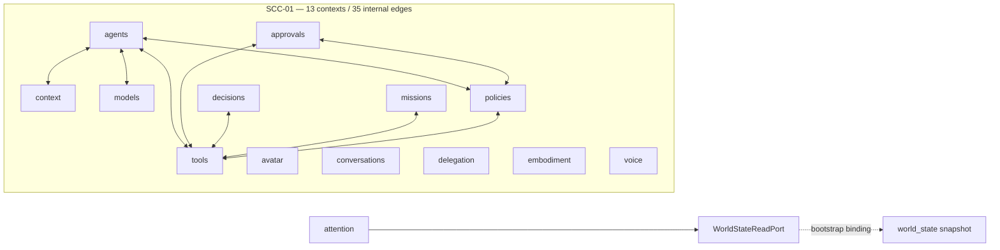

# Current dependency graph

Audit date: **2026-07-15**

Worktree: `backend-freeze-cleanup` at `8196eb11c34442af563b20082bc1666755f4d8a9` (**dirty before audit**)

## Decision summary

Intelligence Trust Boundary adds one bounded context and four governed DAG
edges: `api -> intelligence_boundary`, `commands -> intelligence_boundary`,
`models -> intelligence_boundary` and `tools -> intelligence_boundary`.
Storage, Health and composition bindings live under bootstrap and are excluded
from governance.

The governed bounded-context graph now contains **72 contexts, 261 edges and
one non-trivial SCC**. The remaining SCC is the pre-existing global component
of 13 contexts / 35 internal edges. Its membership and internal-edge count did
not change. The exact Python-module graph remains acyclic.

This Markdown report is the post-intervention authority. Historical JSON and
CSV snapshots were not modified because this phase authorized updates only to
the listed Markdown audit artifacts.

## Baseline

| Gate | Current result |
| --- | --- |
| `uv run --extra dev pytest` | 1,208 passed / 2 skipped in 851.42 s |
| Architecture suite | 113 passed |
| Integrated affected-domain suite | 144 passed |
| Skills functional/boundary/installation suite | 22 passed |
| Named Skills acceptance scenarios | 7 passed |
| Named Project Governance acceptance scenarios | 8 passed |
| Named Intelligence Boundary acceptance scenarios | 8 passed |
| `uv run --extra dev ruff check .` | green |
| `git diff --check` | green; LF/CRLF warnings only |
| OpenAPI paths | 494 |
| OpenAPI operations / unique operation IDs | 550 / 550 |
| OpenAPI schemas | 128 |
| Duplicate operation IDs | 0 |

The worktree was already extensively dirty before this intervention. Existing
user-owned modifications and untracked files were preserved.

## Method

1. Parse `backend/synapse/**/*.py` with Python `ast`.
2. Separate imports guarded by `TYPE_CHECKING` from runtime imports.
3. Group `synapse.main` with API delivery and `synapse.sidecar` with bootstrap.
4. Exclude composition-root edges and outgoing compatibility edges from
   `core.__init__`, `core.app` and `core.model_router` for the governed graph.
5. Run the executable architecture guardrail and enumerate non-trivial SCCs.

Tests, docs, caches, generated files and non-Python artifacts are excluded.
Dynamic calls through injected objects do not create static dependency edges.

## Graph measures

| Measure | Before | After |
| --- | ---: | ---: |
| Production Python files/modules | 444 | 454 |
| Architectural contexts | 71 | 72 |
| Governed cross-context edges | 257 | 261 |
| Exact-module non-trivial SCCs | 0 | 0 |
| Context non-trivial SCCs | 1 | 1 |

The additional modules are the boundary contracts/runtime, bootstrap adapter
and feature, Health contributor and controlled delivery surfaces. The four new
governed edges are acyclic; SCC-01 membership and internal edges are unchanged.

The diagram emphasizes minimum reciprocal cycles. The former
`attention <-> world_state` pair is now a one-way read dependency and is not an
SCC.

## Boundary adjacency affected by this phase

| Context | Governed outgoing adjacency relevant to this phase |
| --- | --- |
| `attention` | core, decisions, observability, world_state |
| `world_state` | core, observability |
| `agent_loop` | attention, core, observability, tools, world_state |
| `bootstrap` | composition edges excluded from governed graph |

All other governed adjacency, including all 35 internal edges of SCC-01, is
unchanged from the preceding inventory.

## Architectural validation

- No production module under `synapse.world_state` imports `synapse.attention`.
- Attention imports no `WorldStateRuntime`, store, storage implementation or
  concrete persistence type.
- `WorldStateReadPort` exposes only `snapshot()`.
- `WorldStateReadAdapter` and `RuntimeEventStateAdapter` are owned by bootstrap.
- Bootstrap constructs one World State runtime, one read adapter, one Attention
  runtime and one event adapter.
- Agent Loop continues to coordinate the same concrete World State and
  Attention runtimes; its behavior and dependency directions are unchanged.
- The governed graph has 247 edges and only SCC-01 at 13/35.

## Documentation comparison

Earlier architecture documents and immutable snapshots may still describe two
or three SCCs. For the current runtime tree, this report and
`current-scc-inventory.md` supersede those historical counts. No unrelated
document was changed in this narrowly scoped phase.

## Limitations

- Context aggregation can expose cycles that are absent at exact-module level.
- Static import analysis cannot infer dynamic imports or runtime calls through
  injected objects.
- Import-symbol frequency measures ownership coupling, not call frequency or
  latency.
