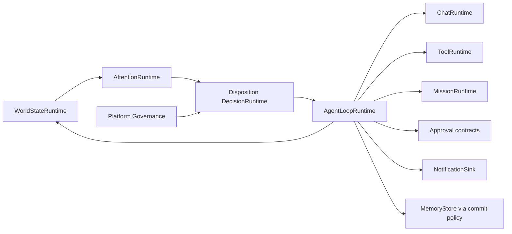

# Agent Loop

Status: **Implemented / Frozen**.

The Agent Loop is a bounded coordinator, not an unrestricted autonomous agent.
Its state machine is independent of per-agent lifecycle.

States are `stopped`, `starting`, `idle`, `observing`, `evaluating`,
`deciding`, `awaiting_approval`, `executing`, `verifying`, `committing`,
`paused`, `degraded`, `stopping`, and `failed`. Invalid transitions fail with
`loop_invalid_state`.

## Cycle guarantees

`run_cycle(trigger=None)` obtains an exclusive local lock, reconciles state,
selects at most one eligible item, creates and persists a decision, records an
execution ledger before side effects, routes through a canonical runtime,
verifies durable evidence, applies memory commit policy, updates World State,
resolves or defers attention, records the cycle, schedules the next timestamp,
and releases the lock in `finally`.

Execution records under `DATA_DIR/agent_loop/executions/` prevent duplicate
actions. A restart that sees `started` without a durable result reports an
unknown outcome and never repeats the action. Approved records are resumed
from the original persisted decision; rejected records are closed without
execution. Tool calls also receive the decision ID as their idempotency key.

Routing rules:

- `respond` -> `ChatRuntime`, verified by the persisted session;
- `execute_reversible_action` -> registered `ToolRuntime`, governed and
  declared reversible, verified by its structured result;
- `start_mission` -> `MissionRuntime`, verified by its persisted reference;
- `require_approval` -> canonical Approval runtime;
- `notify`/`suggest`/`escalate` -> frontend-neutral `NotificationSink`;
- `record_only` -> trace/state and optional policy-controlled memory.

The loop never calls a provider or shell, constructs a model prompt, waits for
long mission work, or accepts arbitrary action injection over API/commands.
