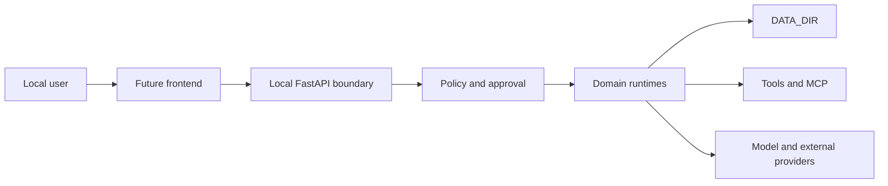

# Security Architecture

No content crosses a declared processing boundary without classification,
ownership, purpose, destination, deterministic minimization, policy, supported
redaction, scoped approval when required, a payload-bound manifest and a
redacted ledger record. Secret is external-denied and restricted is local-only
by default. Provider claims are not technical guarantees; UI-mediated uploads
remain a documented detection limitation.

Project roots are relative/opaque and resolved below an authorized DataDir
root. RFC/review/evidence metadata is redacted and content is never emitted in
observability events. Critical approvals are segregated; ephemeral agents
cannot approve. Private eval references are local-only, and quality gates run
only through the canonical Tool Execution Boundary.

Skill package paths are DATA_DIR-relative and traversal-safe; declared files
are checksummed and size-limited. Skills do not contain secrets or grant tools.
Script preview/execution is only through `SkillScriptExecutionPort` backed by
Tool Runtime policy, permissions and approval.

## Temporary-agent containment

Ephemeral tool scope can only narrow the parent's scope; autonomy and risk ceilings
cannot exceed parent/system policy. Mission/Swarm is the sole creation authority,
resource limits prohibit recursive/unbounded spawning, and critical actions remain
subject to Approval and ToolExecutionPort. Temporary context is redacted and
removed by idempotent cleanup; long-term memory is forbidden.

## Continuous agent safety

The Agent Loop begins in `observe` mode and treats missing allow rules as a
denial. State events are summary-only and sensitive observations are TTL-bound.
Attention scoring cannot grant authority. Disposition selection applies DND,
quiet hours, user presence, allowlists, action/notification budgets, mission
concurrency, tool risk ceiling, and frozen Platform Governance.

Irreversible and critical actions are never automatic. Tool execution requires
a registered canonical tool declared reversible; communication remains under
its frozen domain policy. An execution ledger is written before side effects,
so restart cannot blindly repeat an action. Client APIs cannot mutate raw state
or submit an arbitrary decision/action. Public loop events are allowlisted and
redacted.

Platform governance now centralizes deny-first policy evaluation, autonomy
ceilings, telemetry redaction, structured health, DATA_DIR validation, and
atomic structured writes. See `docs/backend/policy.md`,
`docs/backend/observability.md`, and `docs/backend/foundation-hardening.md`.

Tool execution denies by default without PermissionBridge. Tools declare least-
privilege permissions and call-specific risk. High/critical approvals bind tool,
normalized arguments, actor, call and expiry. Preview/dry-run cannot invoke handlers.
MCP and future filesystem/shell adapters remain subject to the same controls.

## Security Posture

Synapse is local-first, but local execution is not inherently trusted. Models,
tool output, imported files, provider responses, plugins, and future renderer content
are untrusted. The backend is the authority for identity, permissions, policy,
approval, resource scope, and side effects.

The current repository contains important security foundations but is not
release-hardened. Local API authentication, cross-platform secret storage,
desktop trust establishment, and complete adversarial validation remain **in
development or planned**.

## Assets

Protected assets include:

- user files and workspace data;
- agent identity, private memory, and conversation history;
- model and external-provider credentials;
- approval and permission authority;
- tool execution and operating-system access;
- external-provider and communication credentials;
- audio recordings and transcripts;
- audit evidence, migrations, and backups.

## Trust Boundaries

Crossing each arrow requires validation. Loopback networking reduces exposure
but does not authenticate a caller; any local process may attempt to call a
loopback port.

## Identity and Authentication

Actor headers currently provide request context, not sufficient cryptographic
authentication. The production target requires a desktop/backend launch
handshake with an ephemeral high-entropy token, process-scoped lifetime,
constant-time verification, and rotation on restart. Remote binding is
deny-by-default and requires a separate threat model.

The default actor is suitable for local development only. A client cannot
select an arbitrary privileged actor by sending a header.

## Authorization

Authorization combines actor permissions, resource scope, agent capabilities,
effective policy, tool risk, and approval state. Deny takes precedence. A UI,
model, provider, plugin, or coordinator cannot grant permissions.

Resource checks occur at the domain boundary immediately before state read or
side effect. List endpoints filter unauthorized records rather than relying on
clients to hide them.

## Approval

High-risk and critical operations use durable approval records bound to actor,
agent, tool/action, normalized arguments, risk, and expiry. Approval is
single-purpose and cannot be replayed after arguments or risk change. Approving
and executing must re-evaluate current policy.

Speech, model text, tool output, and agent messages are never approval evidence.
The operator must receive a concrete description of the action and affected
resource.

## Filesystem Safety

Operational paths resolve through `DataDir` or an explicitly approved workspace
root. Reject absolute paths where a relative resource is expected, path
traversal, symlink escapes, reserved names, and control characters. Validate
the resolved path, not only the input string.

Writes use temporary files and atomic replacement where supported. Multi-file
operations define rollback. Imported archives and plugins are unpacked with
size, count, type, and traversal limits.

## Secrets

Secrets must not be stored in agent YAML/Markdown, source-controlled data,
future renderer persistence, logs, event payloads, command history, or API responses.
Persist secret references and retrieve values only at execution time.

Any existing platform-specific credential mechanism is an alpha constraint,
not a cross-platform contract. The release target needs an OS-backed secret
store abstraction for Windows, macOS, and Linux, with migration, deletion,
rotation, and locked-store behavior. Environment variables remain acceptable
for local development and automated deployment, not as the desktop vault.

## Model and Prompt Threats

Prompts, retrieved memory, web content, files, and provider output may contain
instructions designed to override policy. System policy and tool authorization
are code-level controls, never prompt-only controls.

Tool arguments are validated against schemas and resource scopes after model
generation. Sensitive context is minimized before provider transmission.
Provider fallback cannot silently move local data to a cloud service.

## Tools, MCP, and Plugins

Tools declare capabilities, risk, input schema, side effects, and execution
boundary. Unknown tools are denied. Shell, filesystem write, network,
credential, and agent-administration operations require strict scope and may
require approval.

MCP servers and provider plugins are separate trust principals. The target
requires manifest validation, explicit enablement, version pinning, integrity
or signature verification, capability allowlists, bounded process/network
access, health timeouts, and revocation. Plugin metadata is not proof that code
is safe or installed.

## Future Frontend Security

For any future desktop client:

- context isolation remains enabled;
- renderer privileges remain constrained;
- preload or bridge surfaces expose a typed allowlist, not generic IPC;
- CSP rejects arbitrary scripts and unsafe navigation;
- external links open through an explicit allowlist and user gesture;
- future renderer content and model Markdown are sanitized;
- backend tokens remain outside renderer-readable persistence;
- native file access uses scoped handles or validated roots;
- frontend dependency and runtime updates receive security review.

The legacy Tauri/React security settings do not define the V3 boundary.

## Network Security

Default backend binding is `127.0.0.1`. CORS must allow only the packaged client
origins or development origins explicitly configured for that environment.
Outbound provider requests use TLS, bounded timeouts, response-size limits, and
redacted diagnostics.

Remote access, LAN discovery, inbound webhooks, and browser clients are out of
scope until authentication, CSRF/origin handling, rate limiting, and deployment
guidance are designed together.

## Logging, Events, and Audit

Security-relevant actions record actor, action, resource, decision, policy
reason, correlation, timestamp, and outcome. Logs and events redact credentials,
authorization headers, full sensitive prompts, raw audio, and unnecessary
personal data.

Audit records are append-oriented and retention-controlled. They are not a
substitute for backup and are not claimed tamper-proof until integrity chaining
and protected storage are implemented.

## Data Retention and Deletion

Each record class defines sensitivity, retention, and deletion behavior.
Deleting an agent or conversation must account for derived summaries, indexes,
audio, artifacts, events, and backups. Retention cleanup is policy-driven and
audited; dangling sensitive derivatives are a security defect.

## Security Testing

Required tests include permission denial, actor spoofing, approval replay,
argument substitution, path and symlink traversal, malformed persisted data,
secret redaction, prompt-injected tool calls, provider timeout/oversize
responses, plugin manifest attacks, IPC schema rejection, and cancellation
races.

## Release Blockers

Synapse must not be presented as release-hardened until:

- local API caller authentication is enforced;
- release-grade secret storage works on supported platforms;
- all backend tests and security regressions are green;
- Electron boundary and CSP tests are green;
- dependencies, licenses, packages, and update path are reviewed;
- backup, migration, recovery, and secure deletion are validated;
- a documented threat-model review has no unresolved critical findings.

Security issues should be reported privately to the maintainers once a private
channel is defined. Do not include credentials or private user data in public
issues.

## Administrative data maintenance

Maintenance is admin-only and default-deny at both permission and policy layers.
Public input cannot contain paths or traversal syntax. Plans expire and bind
scope, actions, checksum and revision; destructive execution requires explicit
confirmation, and high-risk plans require the exact linked approval. Symlinks,
escaped roots, recent files and unknown file kinds are never cleanup candidates.
Restart recovery records interrupted work but never resumes deletion.

## Perception and visual data

Screen and camera inputs are sensitive by default. Captures require explicit
invocation and policy authorization, denylisted windows are rejected before
persistence, raw assets have short retention, and events never contain pixels,
audio, transcripts, OCR text, or absolute paths. Camera/OCR remain disabled by
default. Enabling a provider does not authorize capture by itself.
# Operational storage safety

Storage roots must be resolved through DataDir before construction. Collection and
record IDs are validated; traversal, relative roots and symlink records are
rejected. Temporaries, backups, lock files and quarantine remain under the resolved
collection root. Structured errors and neutral events expose no absolute paths or
payload content, and sensitive IDs can be hashed.
