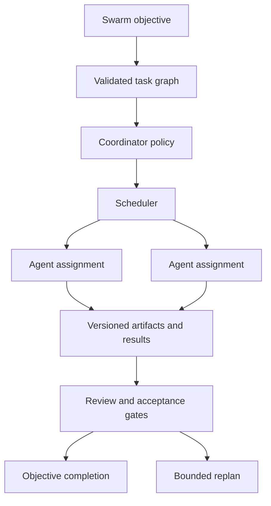

# Swarm Orchestration

Governed coding flows bind RFC revision/checksum and Implementation Plan
revision/checksum into Missions and ephemeral specifications. Swarm may plan,
review, implement, verify and collect evidence, but cannot approve a critical
RFC alone, alter scope silently or execute a stale plan.

Workforce tasks may request skill IDs. Bootstrap supplies a neutral resolver;
ephemeral identities receive bounded leases whose tool scope is an intersection,
never an expansion. Missing skills record `skill.gap` and do not trigger creation.

## Dynamic ephemeral workforce

Swarm can request a bounded `EphemeralWorkforcePlan` for complex/specialist mission
DAGs. Resource Pressure may reduce concurrency or defer work. Applying a plan
creates leased identities, associates Workers, annotates TaskAttempts and cleans
temporary context after verified results. Simple tasks do not create a swarm by
default, and no public endpoint/command can spawn arbitrary agents.

## Status

Swarm orchestration is **planned**. Synapse already has agents, conversations,
delegation, missions, workers, scheduling, policies, approvals, events, and
memory foundations, but their existence must not be interpreted as a complete
swarm runtime.

Swarm work starts only after those prerequisite domains are stable and their
global tests are green. No frontend or API may advertise autonomous swarms
before that gate.

## Definition

A swarm is a policy-bounded group of registered agents collaborating on a
durable objective through an explicit task graph. It is not an unrestricted
agent-spawning mechanism, a shared chat room, or a prompt asking one model to
pretend to be several roles.

Every participant remains a normal Synapse agent with identity, capabilities,
permissions, model policy, memory scope, audit history, and lifecycle state.

## Prerequisites

- stable agent identity and registry;
- green delegation lifecycle, retry, timeout, completion, and recovery;
- stable mission and worker execution;
- effective policy and approval enforcement;
- correlated event and observability contracts;
- scoped memory retrieval and writes;
- idempotent task transitions;
- cancellation and dead-letter recovery.

## Target Model

The coordinator is a role governed by policy, not a privileged bypass. It can
propose decomposition, assignment, cancellation, and replanning only within
declared budgets and permissions.

## Swarm Specification

A durable swarm record contains:

- stable swarm and objective identifiers;
- creator and responsible actor;
- participant agent IDs and role bindings;
- task graph with dependencies and acceptance criteria;
- policy snapshot and approval references;
- time, token, model, tool, and retry budgets;
- memory and artifact scopes;
- lifecycle status and version;
- correlation root, timestamps, and audit references.

Configuration uses references to registered agents. It does not copy or mutate
agent identity files.

## Lifecycle

Target states are `draft`, `validated`, `awaiting_approval`, `ready`, `running`,
`paused`, `completed`, `failed`, and `cancelled`. State transitions use
compare-and-set or equivalent optimistic concurrency and emit one durable
event. Terminal states are immutable except for an explicit archival action.

Validation checks graph acyclicity, role coverage, agent availability,
capabilities, policy, budgets, and resource scopes before execution.

## Scheduling

The scheduler selects only eligible active agents. Selection considers required
capabilities, current workload, model availability, data locality, policy,
priority, and dependency readiness. Deterministic tie-breaking is required for
reproducible tests.

No task may be active under multiple leases unless the task contract explicitly
allows parallel replicas. Leases expire and can be recovered without creating
duplicate accepted results.

## Communication

Agent-to-agent communication uses the existing message and delegation
boundaries. Messages carry sender, recipient, objective, task, correlation, and
causation. Unstructured messages cannot mutate task state.

Results are submitted as typed task outputs and optional artifact references.
Reviewers accept or reject against declared criteria; a model's self-reported
success is not completion evidence.

## Memory and Artifacts

Swarm memory is an explicit scope, separate from agent-private and user-private
memory. Participants receive only the minimum context required for assigned
tasks. Writes record author, task, source, sensitivity, and retention.

Artifacts are immutable or versioned, checksummed, and rooted in an approved
workspace. Concurrent edits require a merge strategy; last-writer-wins is not
the default for source or specification files.

## Policy and Budgets

Effective permission is the intersection of system, swarm, agent, task, tool,
and user policy. A coordinator cannot delegate a capability it does not have.
High-risk tools and sensitive agent provisioning remain approval-gated.

Budgets are hard limits, not prompt guidance. Exhausting time, token, cost,
retry, or concurrency budget pauses or fails work according to policy and
produces an operator-visible reason.

## Failure and Recovery

Each task defines retryability and timeout separately. Recovery uses durable
state, idempotency keys, leases, and completion signals. Ambiguous tool effects
are sent to review or dead letter rather than blindly repeated.

Replanning is bounded and versioned. It cannot erase previous attempts, widen
permissions, add participants, or increase budgets without policy evaluation
and, where required, approval.

## Observability

Events provide a complete causal chain from objective to task, delegation,
model call, tool call, artifact, review, and completion. Required metrics
include queue depth, active leases, completion latency, retry count, budget
consumption, failure class, and per-agent workload. Sensitive content is not a
metric label.

## Non-goals

- unbounded recursive agent creation;
- peer agents granting themselves permissions;
- shared unrestricted memory;
- completion based only on generated prose;
- hidden cloud fallback;
- execution without durable state and cancellation;
- a swarm-specific duplicate of agents, missions, or delegation.

## Delivery Gate

Swarm is considered implemented only after a versioned contract, lifecycle and
recovery tests, policy adversarial tests, deterministic scheduler tests,
multi-agent integration tests, cancellation tests, and an operator-visible V3
workflow are green without increasing the backend failure baseline.
