# Synapse V2 Runtime Walkthrough

Date: 2026-06-14

Scope: validate whether the current Synapse foundation works as a system. No product feature was implemented for this validation.

Update: after the Chat Runtime and Model Adapter step, the previous "user talks to Artemis" architectural gap is partially closed. A real runtime flow now exists for:

```text
User -> ChatRuntime -> ContextLoader -> AgentIdentityRuntime -> AgentRuntime -> ModelRouter/ModelAdapter -> response -> events/logs/session
```

Remaining non-goals: no UI, no voice, no avatar, no communication integration, no perception runtime, no mobile approval UI, and no autonomous multi-step agent loop.

## Technical Execution

The scenario was executed against a temporary `DATA_DIR`, not the repository `data/` directory.

Temporary agents were seeded for validation:

- `artemis`
- `researcher`

The runtime services used were the existing services:

- `RuntimeContainer`
- `MemoryStore`
- `TaskRuntime`
- `AgentCommunication`
- `EventBus`
- `AgentIdentityRuntime`
- `ContextLoader`
- `PermissionManager`

Technical result summary:

```json
{
  "global_memory_read": true,
  "artemis_memory_read": true,
  "request_initial_status": "pending",
  "researcher_message_count_after_restart": 1,
  "artemis_message_count_after_restart": 1,
  "task_status_before_restart": "completed",
  "task_status_after_restart": "completed",
  "history_count_after_restart": 2,
  "log_line_count_before_restart": 22,
  "events_log_exists_after_restart": true
}
```

Event types generated during the technical run:

```text
runtime.started
runtime.started
permission.decision
permission.decision
permission.decision
task.created
permission.decision
agent.message.sent
permission.decision
permission.decision
agent.message.status_changed
permission.decision
agent.message.sent
permission.decision
agent.message.status_changed
permission.decision
permission.decision
agent.message.status_changed
permission.decision
task.updated
permission.decision
context.loaded
```

Important limitation in the original validation: conversation could only be represented as session history. Current status: `ChatRuntime` now persists sessions under `chats/sessions/` and uses `ContextLoader` for non-command turns. Model responses can now request controlled tool calls through `ToolRouter`; high/critical risk calls create persisted approval requests before execution. Once approved, the runtime can resume and execute the saved tool call without the user resending it. Multi-step planning and streaming remain out of scope.

Agent identity status: agents now load structured operational identity through `AgentIdentityRuntime`. Artemis, Researcher, Atlas, Hermes, and Vigil exist as base agents in `DATA_DIR`, each with distinct roles, focus areas, preferred tools, forbidden tools, communication styles, and operational rules.

## Step-by-Step Walkthrough

### 1. User talks to Artemis

Status: executable at runtime level.

Components:

- `ChatRuntime`
- `ContextLoader`
- `AgentIdentityRuntime`
- `AgentRuntime`
- `ModelRouter`
- `MockModelAdapter` for deterministic tests, or configured model adapter
- `ToolRouter` when the model response requests a tool
- `ApprovalManager` when the tool risk policy requires approval
- `ApprovalResumeRuntime` when an approval is approved and resumed
- `EventBus`
- `DataDir`

Files read:

- `memory/SYSTEM.md`
- `memory/USER.md`
- `memory/MEMORY.md`
- `agents/artemis/SOUL.md`
- `agents/artemis/CONFIG.yaml`
- `agents/artemis/MEMORY.md`
- `agents/artemis/SKILLS.md`
- existing `chats/sessions/<session_id>.json` if the session already exists

Files written:

- `chats/sessions/<session_id>.json`
- `logs/events.jsonl`
- tool-specific files when requested, such as tasks or agent messages
- `approvals/<approval_id>.yaml` when a sensitive tool requires human approval

Events generated:

- `chat.message_received`
- `permission.decision`
- `context.loaded`
- `chat.context_loaded`
- `agent.run.started`
- forbidden tool blocking before `ToolRouter`, when applicable
- `tool.requested`, when applicable
- `tool.permission_checked`, when applicable
- `approval.requested`, when risk policy requires approval
- `approval.approved` or `approval.rejected`, when a human decision is made
- `approval.resumed`, when an approved request executes successfully
- `tool.executed` or `tool.failed`, when applicable
- `agent.run.completed`
- `chat.response_generated`
- `chat.session_persisted`

Risks:

- Chat history is persisted as session state, but it must remain separate from memory.
- Tool calling is controlled, permission-gated, and approval-gated for high/critical risk tools, but only supports simple single-pass execution.
- Agents now have distinct identities, but identity schema versioning and editing workflows are not implemented.
- Real model execution depends on configured adapters; deterministic tests use `MockModelAdapter`.

Architectural gap:

- Add streaming, multi-step tool planning, and stronger session schema/versioning before UI chat grows.

### 2. Artemis reads global memory

Status: executable.

Components:

- `MemoryStore`
- `PermissionManager`
- `EventBus`
- `DataDir`

Files read:

- `memory/MEMORY.md`

Files written:

- `logs/events.jsonl`

Events generated:

- `permission.decision`

Risks:

- Permission config is loaded at runtime startup, so changes require runtime recreation.
- Memory is raw markdown with no schema/provenance yet.

Technical validation:

- `runtime.memory.read_global(artemis, "MEMORY.md")` returned expected global memory content.

### 3. Artemis reads her own memory

Status: executable.

Components:

- `MemoryStore`
- `PermissionManager`
- `EventBus`
- `DataDir`

Files read:

- `agents/artemis/MEMORY.md`

Files written:

- `logs/events.jsonl`

Events generated:

- `permission.decision`

Risks:

- The runtime can read agent memory, but there is no higher-level memory policy for summarization, conflict resolution, or compaction.
- Artemis now exists as a base bootstrap agent. Older `DATA_DIR` instances created before the identity runtime may need a bootstrap/migration pass.

Technical validation:

- `runtime.memory.read_agent_memory(artemis, "artemis")` returned expected Artemis memory content.

### 4. Artemis creates a task

Status: executable.

Components:

- `TaskRuntime`
- `PermissionManager`
- `EventBus`
- `DataDir`

Files read:

- `config/permissions.yaml`
- existing task directories when listing or later loading

Files written:

- `tasks/active/<task_id>.json`
- `logs/events.jsonl`

Events generated:

- `permission.decision`
- `task.created`

Risks:

- Task write is not atomic.
- Task metadata is free-form; there is no strict assignment/project schema yet.
- No task event history file exists besides global event log and metadata notes.

Technical validation:

- `runtime.tasks.create_task(...)` created a real JSON task file under `tasks/active`.

### 5. Artemis sends a message to Researcher

Status: executable.

Components:

- `AgentCommunication`
- `AgentRegistry`
- `PermissionManager`
- `EventBus`
- `DataDir`

Files read:

- `agents/artemis/CONFIG.yaml`
- `agents/researcher/CONFIG.yaml`
- `config/permissions.yaml`

Files written:

- `agents/researcher/INBOX.md`
- `agents/researcher/messages/<message_id>.yaml`
- `logs/events.jsonl`

Events generated:

- `permission.decision`
- `agent.message.sent`

Risks:

- Message file write is not atomic.
- There is no delivery retry model.
- There is no separate outbox for Artemis.
- Agent permissions in `CONFIG.yaml` are not the source of truth for `PermissionManager`; permissions still come from `config/permissions.yaml`.

Technical validation:

- A structured message was created with status `pending`.
- The human-readable `INBOX.md` projection was updated.

### 6. Researcher receives the message

Status: executable.

Components:

- `AgentCommunication`
- `AgentRegistry`
- `PermissionManager`
- `EventBus`
- `DataDir`

Files read:

- `agents/researcher/messages/<message_id>.yaml`
- `agents/researcher/CONFIG.yaml`
- `config/permissions.yaml`

Files written:

- `agents/researcher/messages/<message_id>.yaml` when marked read
- `logs/events.jsonl`

Events generated:

- `permission.decision`
- `agent.message.status_changed` when message becomes `read`

Risks:

- Receiving means listing/reading message records; no background inbox processing exists.
- No agent loop automatically reacts to pending messages.

Technical validation:

- `runtime.communication.list_messages(researcher, "researcher")` returned the pending message.
- `mark_read(...)` changed status to `read` and emitted an event.

### 7. Researcher responds

Status: executable.

Components:

- `AgentCommunication`
- `AgentRegistry`
- `PermissionManager`
- `EventBus`
- `DataDir`

Files read:

- `agents/researcher/CONFIG.yaml`
- `agents/artemis/CONFIG.yaml`
- `config/permissions.yaml`

Files written:

- `agents/artemis/INBOX.md`
- `agents/artemis/messages/<response_id>.yaml`
- `agents/researcher/messages/<request_id>.yaml` when request is marked processed
- `logs/events.jsonl`

Events generated:

- `permission.decision`
- `agent.message.sent`
- `agent.message.status_changed` when the original request becomes `processed`

Risks:

- Response is manually invoked by runtime calls. There is no autonomous Researcher processing loop.
- The request/response relationship exists through shared `task_id`, not a formal conversation thread id.

Technical validation:

- Researcher sent a structured response to Artemis.
- The original Researcher message was marked `processed`.

### 8. Artemis receives the response

Status: executable.

Components:

- `AgentCommunication`
- `AgentRegistry`
- `PermissionManager`
- `EventBus`
- `DataDir`

Files read:

- `agents/artemis/messages/<response_id>.yaml`
- `agents/artemis/CONFIG.yaml`
- `config/permissions.yaml`

Files written:

- `agents/artemis/messages/<response_id>.yaml` when marked read
- `logs/events.jsonl`

Events generated:

- `permission.decision`
- `agent.message.status_changed`

Risks:

- Artemis does not automatically consume or reason over the response.
- No inbox notification or scheduler exists yet.

Technical validation:

- Artemis had one response message after restart.
- `mark_read(...)` updated its status and emitted an event.

### 9. Task is completed

Status: executable.

Components:

- `TaskRuntime`
- `PermissionManager`
- `EventBus`
- `DataDir`

Files read:

- `tasks/active/<task_id>.json`
- `config/permissions.yaml`

Files written:

- `tasks/completed/<task_id>.json`
- `logs/events.jsonl`

Files deleted/moved:

- `tasks/active/<task_id>.json` is deleted after the completed task record is written.

Events generated:

- `permission.decision`
- `task.updated`

Risks:

- Update is delete-then-write, not atomic.
- A crash between delete and write can lose the task.

Technical validation:

- The task status was `completed` before restart and remained `completed` after restart.

### 10. Events are registered

Status: executable.

Components:

- `EventBus`
- all runtime services that emit events

Files read:

- `logs/events.jsonl` when tailing events

Files written:

- `logs/events.jsonl`

Events generated:

- `runtime.started`
- `permission.decision`
- `task.created`
- `agent.message.sent`
- `agent.message.status_changed`
- `task.updated`
- `context.loaded`

Risks:

- Events are append-only JSONL with no rotation, indexing, or correlation id.
- Events are not written atomically as part of the same transaction as task/message changes.

Technical validation:

- 22 event log lines existed before the simulated restart.

### 11. Logs are registered

Status: partial.

Components:

- `EventBus`

Files read:

- `logs/events.jsonl`

Files written:

- `logs/events.jsonl`

Events generated:

- Same event types listed in step 10.

Risks:

- The only implemented log is the runtime event log.
- There is no separate application log, structured request log, tool trace log, or log retention policy.

Architectural gap:

- Add logging policy later: event log for domain events, application logs for runtime diagnostics, and request/task correlation ids.

### 12. Context is reconstructed correctly

Status: executable for current context scope.

Components:

- `ContextLoader`
- `AgentRegistry`
- `TaskRuntime`
- `PermissionManager`
- `EventBus`
- `DataDir`

Files read:

- `memory/SYSTEM.md`
- `memory/USER.md`
- `memory/MEMORY.md`
- `agents/artemis/SOUL.md`
- `agents/artemis/MEMORY.md`
- `agents/artemis/SKILLS.md`
- `tasks/completed/<task_id>.json`

Files written:

- `logs/events.jsonl`

Events generated:

- `permission.decision`
- `context.loaded`

Context source order observed:

```text
memory/SYSTEM.md
memory/USER.md
memory/MEMORY.md
agents/artemis/SOUL.md
agents/artemis/MEMORY.md
agents/artemis/SKILLS.md
tasks/completed/<task_id>.json
history item
history item
```

Risks:

- Chat history is correctly separate from memory, but there is no chat session persistence yet.
- Relevant tasks are detected through free-form metadata.
- Project context was not part of this specific walkthrough because no project was created.

Technical validation:

- Context before restart and after restart had the same source order.
- Two session history items were included as history, not memory.

### 13. System restarts

Status: executable as runtime recreation.

Components:

- `create_runtime`
- `RuntimeContainer`
- `DataDir`
- `ConfigStore`
- `PermissionManager`
- `EventBus`
- `AgentRegistry`
- `TaskRuntime`
- `AgentCommunication`
- `ContextLoader`

Files read:

- `config/system.yaml`
- `config/permissions.yaml`
- agent configs as needed after restart
- existing tasks/messages when queried after restart

Files written:

- `logs/events.jsonl`

Events generated:

- `runtime.started`

Risks:

- This validates service recreation, not a full process manager or graceful shutdown.
- There is no background worker lifecycle yet.

Technical validation:

- A new runtime was created against the same temporary `DATA_DIR`.

### 14. State is preserved

Status: executable.

Components:

- `TaskRuntime`
- `AgentCommunication`
- `ContextLoader`
- `EventBus`
- `DataDir`

Files read:

- `tasks/completed/<task_id>.json`
- `agents/researcher/messages/<request_id>.yaml`
- `agents/artemis/messages/<response_id>.yaml`
- `agents/researcher/INBOX.md`
- `agents/artemis/INBOX.md`
- `logs/events.jsonl`
- memory and agent files used by context reconstruction

Files written:

- `logs/events.jsonl` for runtime restart and context reload

Events generated:

- `runtime.started`
- `permission.decision`
- `context.loaded`

Risks:

- State is preserved because it is file-backed.
- There is no migration/versioning for persisted structured records yet.
- There is no consistency checker for orphaned task/message/event records.

Technical validation:

- Task status after restart: `completed`.
- Researcher message count after restart: `1`.
- Artemis message count after restart: `1`.
- Event log still existed after restart.

## Complete System Flow

1. Runtime starts and loads config, permissions, event bus, identities, agents, memory, tasks, tools, approvals, context loader, command runtime, and device registry.
2. A chat turn with Artemis is persisted under `chats/sessions/` through `ChatRuntime`.
3. `ContextLoader` loads global memory, Artemis identity, Artemis memory, skills, relevant tasks, and recent session history.
4. Artemis reads global and agent memory through runtime-owned services, not direct file access.
5. Artemis creates a persisted task through `TaskRuntime`.
6. Artemis sends a structured message to Researcher through `AgentCommunication`.
7. Researcher lists pending messages and marks the request as read.
8. Researcher sends a structured response to Artemis and marks the request processed.
9. Artemis lists received messages and marks the response read.
10. Artemis completes the task through `TaskRuntime`.
11. `EventBus` records permission decisions, task events, message events, tool events, approval events, context load, chat events, and runtime starts.
12. `ContextLoader` reconstructs typed context from memory, identity, relevant tasks, and session history.
13. Runtime is recreated against the same `DATA_DIR`.
14. Tasks, messages, inbox projections, memory, identity files, chat sessions, approvals, and event log remain available.

With controlled tool calling, steps 4 and 5 can also be initiated by a model-produced `ToolCallRequest`. For low-risk tools, execution path is:

```text
AgentRuntime -> ToolRouter -> PermissionManager -> ToolRegistry -> Tool implementation
```

For high/critical tools, approval and resume path is:

```text
AgentRuntime -> ToolRouter -> PermissionManager -> ApprovalManager(pending)
/approve -> ApprovalResumeRuntime -> ToolRouter -> PermissionManager -> ToolRegistry -> ApprovalManager(resumed)
```

## Execution Diagram

```mermaid
sequenceDiagram
    participant User
    participant Artemis
    participant Runtime
    participant Identity as "AgentIdentityRuntime"
    participant Memory as "MemoryStore"
    participant Tasks as "TaskRuntime"
    participant A2A as "AgentCommunication"
    participant Researcher
    participant Context as "ContextLoader"
    participant Events as "EventBus"
    participant Files as "DATA_DIR"

    User->>Runtime: "POST/chat or ChatRuntime.chat"
    Runtime->>Context: "load context for artemis"
    Context->>Identity: "load_identity(artemis)"
    Identity->>Files: "read SOUL.md, CONFIG.yaml, SKILLS.md"
    Context->>Files: "read memory and recent session history"
    Runtime->>Artemis: "run with structured identity and context"
    Artemis->>Memory: "read_global(MEMORY.md)"
    Memory->>Events: "permission.decision"
    Memory->>Files: "read memory/MEMORY.md"
    Artemis->>Memory: "read_agent_memory(artemis)"
    Memory->>Files: "read agents/artemis/MEMORY.md"
    Artemis->>Tasks: "create_task"
    Tasks->>Files: "write tasks/active/<task>.json"
    Tasks->>Events: "task.created"
    Artemis->>Runtime: "model tool call request"
    Runtime->>Events: "tool.requested"
    Runtime->>Events: "tool.permission_checked"
    Runtime->>Events: "approval.requested when high/critical"
    Runtime->>Runtime: "approval approved"
    Runtime->>Events: "approval.approved"
    Runtime->>Runtime: "resume approved tool call"
    Runtime->>Files: "tool writes through ToolRegistry"
    Runtime->>Events: "approval.resumed"
    Runtime->>Events: "tool.executed or tool.failed"
    Artemis->>A2A: "send_agent_message(to researcher)"
    A2A->>Files: "append researcher/INBOX.md"
    A2A->>Files: "write researcher/messages/<message>.yaml"
    A2A->>Events: "agent.message.sent"
    Researcher->>A2A: "list_messages + mark_read"
    A2A->>Events: "agent.message.status_changed"
    Researcher->>A2A: "send response(to artemis)"
    A2A->>Files: "append artemis/INBOX.md"
    A2A->>Files: "write artemis/messages/<response>.yaml"
    A2A->>Events: "agent.message.sent"
    Artemis->>A2A: "mark response read"
    A2A->>Events: "agent.message.status_changed"
    Artemis->>Tasks: "update_task(completed)"
    Tasks->>Files: "move active task to completed"
    Tasks->>Events: "task.updated"
    Artemis->>Context: "load(artemis, history)"
    Context->>Files: "read memory, identity, task"
    Context->>Events: "context.loaded"
    Runtime->>Runtime: "restart with same DATA_DIR"
    Runtime->>Files: "read persisted state"
```



## Gaps Found

1. Chat Runtime exists, but has no streaming or multi-step tool loop.
   User-to-agent turns are executable and persisted. Models can request simple structured tool calls, but there is no iterative observe/think/act cycle yet.

1A. Approval Gate exists, but has no UI/mobile approval surface.
    Approval can be managed through runtime commands and API endpoints only.

1B. Agent Identity Runtime exists, but has no schema version, editor, or migration workflow.
    SOUL, CONFIG, and SKILLS are loaded separately and exposed to runtime context, but identity records are still file-authored and manually maintained.

2. No autonomous agent worker loop exists.
   Artemis and Researcher can run through `ChatRuntime`/`AgentRuntime`, but they do not autonomously process inboxes or run scheduled work.

3. Persistent chat/session log exists, but is basic.
   Sessions persist under `data/chats/sessions/`, but there is no schema version, attachment model, retention policy, or search.

4. Logs are only event logs.
   `logs/events.jsonl` works, but there is no separate application diagnostic log or request correlation.

5. Message threading is incomplete.
   Request and response share `task_id`, but there is no formal thread/conversation id.

6. Agent inbox processing is manual.
   Pending messages are not picked up by a scheduler or background worker.

7. Task and message writes are not atomic.
   Crashes during update can leave inconsistent state.

8. Base agents now exist, but older data directories may not have them.
   Artemis, Researcher, Atlas, Hermes, and Vigil are seeded for new `DATA_DIR` instances. Existing local directories created earlier need an explicit bootstrap or migration path.

9. Permission source is split.
   Agent config declares permissions, but `PermissionManager` enforces permissions from `config/permissions.yaml`.

10. No persisted state migration/versioning exists.
    YAML message records, identity configs, chat sessions, approvals, and JSON task records have no schema version.

## Correction Priorities

Priority 1:

- Add message thread/conversation ids for agent-to-agent exchanges.
- Make task and message writes atomic.
- Add schema versioning for chat sessions, tasks, and messages.
- Add schema versioning and validation tooling for agent identity files.
- Add multi-step tool observation and final model follow-up.
- Add approval notifications, remote-safe approval workflows, and session message updates after resume.

Priority 2:

- Add a background inbox processor/scheduler for agent message handling.
- Add request/task/event correlation ids.
- Add schema version fields for structured persisted records.

Priority 3:

- Connect agent `CONFIG.yaml` permissions to `PermissionManager` or document the single source of truth more strictly.
- Add a diagnostic application log separate from domain event log.
- Add identity editing and review workflows before allowing non-technical users to modify base agents.

Priority 4:

- Add real model integration and agent execution loop.
- Add API endpoints for session/chat and command runtime only after the runtime contracts are stable.
