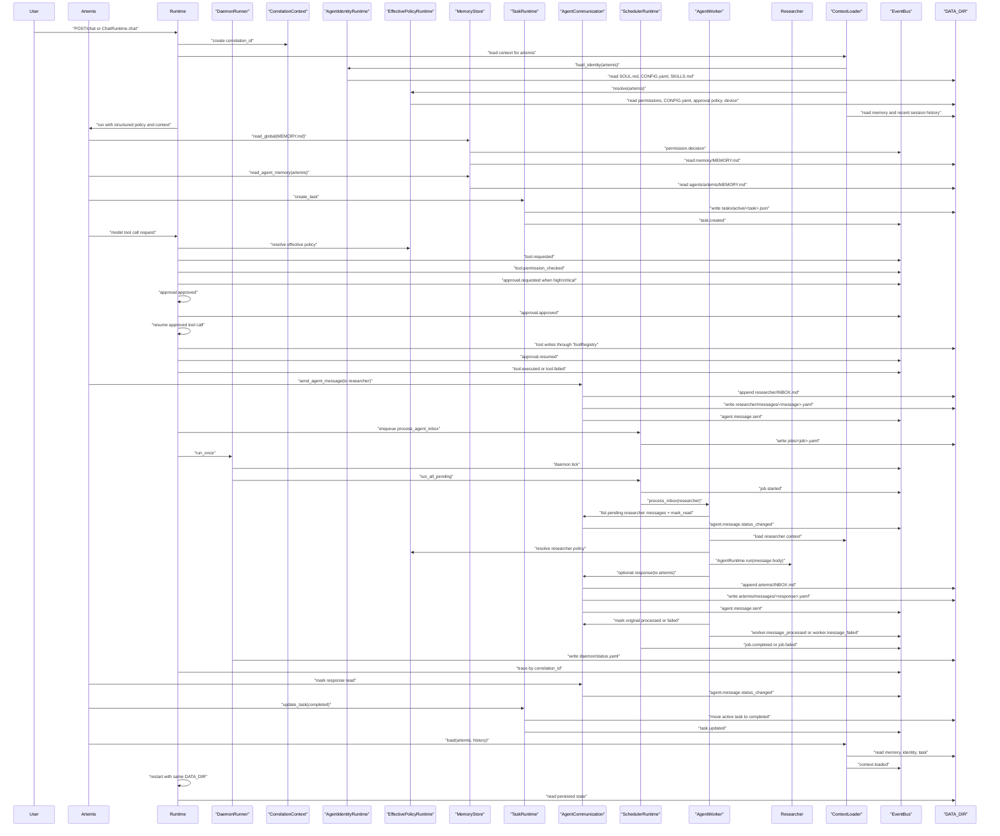

# Synapse V2 Runtime Walkthrough

## Desktop Alpha Critical Smoke

1. Stop manually started backends and launch only `desktop/release/synapse-desktop.exe`.
2. Confirm no console window opens and `/api/health` returns 200.
3. Confirm `desktop.jsonl` records `source=release_bundle`, sidecar path, working directory and port.
4. Confirm the topbar reports the API online and no raw `Failed to fetch` text appears.
5. Confirm Insight reports measured local values with mode `partial` and explicit GPU limitations.
6. Confirm Models reports `real`, `partial`, or `empty` without fabricated detections.

## Provider Settings

1. Open **Configuracoes**, edit an endpoint or default model, and save.
2. Confirm Model Hub refreshes without restarting the app.
3. Add an API key and confirm only its masked suffix appears after reload.
4. Run **Testar** and confirm the controlled status is shown.
5. Clear the key and confirm the old value is never returned.

Date: 2026-06-14

Scope: validate whether the current Synapse foundation works as a system. No product feature was implemented for this validation.

Update: after the Chat Runtime and Model Adapter step, the previous "user talks to Artemis" architectural gap is partially closed. A real runtime flow now exists for:

```text
User -> ChatRuntime -> ContextLoader -> AgentIdentityRuntime -> EffectivePolicyRuntime -> AgentRuntime -> ModelRouter/ModelAdapter -> response -> events/logs/session
```

Remaining non-goals: no UI, no voice, no avatar, no perception runtime, no mobile approval UI, no automatic email sending, and no autonomous multi-step agent loop.

## Technical Execution

The scenario was executed against a temporary `DATA_DIR`, not the repository `data/` directory.

Temporary agents were seeded for validation:

- `artemis`
- `researcher`

The runtime services used were the existing services:

- `RuntimeContainer`
- `MemoryStore`
- `TaskRuntime`
- `AgentCommunication`
- `EventBus`
- `AgentIdentityRuntime`
- `EffectivePolicyRuntime`
- `SchedulerRuntime`
- `DaemonRunner`
- `CorrelationContext`
- `ContextLoader`
- `PermissionManager`

Technical result summary:

```json
{
  "global_memory_read": true,
  "artemis_memory_read": true,
  "request_initial_status": "pending",
  "researcher_message_count_after_restart": 1,
  "artemis_message_count_after_restart": 1,
  "task_status_before_restart": "completed",
  "task_status_after_restart": "completed",
  "history_count_after_restart": 2,
  "log_line_count_before_restart": 22,
  "events_log_exists_after_restart": true
}
```

Event types generated during the technical run:

```text
runtime.started
runtime.started
permission.decision
permission.decision
permission.decision
task.created
permission.decision
agent.message.sent
permission.decision
permission.decision
agent.message.status_changed
permission.decision
agent.message.sent
permission.decision
agent.message.status_changed
permission.decision
permission.decision
agent.message.status_changed
permission.decision
task.updated
permission.decision
context.loaded
```

Important limitation in the original validation: conversation could only be represented as session history. Current status: `ChatRuntime` now persists sessions under `chats/sessions/` and uses `ContextLoader` for non-command turns. Model responses can now request controlled tool calls through `ToolRouter`; high/critical risk calls create persisted approval requests before execution. Once approved, the runtime can resume and execute the saved tool call without the user resending it. Multi-step planning and streaming remain out of scope.

Agent identity status: agents now load structured operational identity through `AgentIdentityRuntime`. Artemis, Researcher, Atlas, Hermes, and Vigil exist as base agents in `DATA_DIR`, each with distinct roles, focus areas, preferred tools, forbidden tools, communication styles, and operational rules.

Effective policy status: `EffectivePolicyRuntime` now resolves the single policy object used by `AgentRuntime`, `ToolRouter`, `ApprovalResumeRuntime`, `ContextLoader`, and `/policy`. It combines global permissions, agent `CONFIG.yaml`, `AgentIdentity`, approval policy, and optional device constraints.

Observability status: `EventBus` now writes correlation-aware envelopes. Durable records for tasks, agent messages, approvals, jobs, and chat sessions also persist optional correlation metadata. Chat turns, tool calls, approval creation, job execution, daemon ticks, worker processing, and related records can be traced by `correlation_id` through `/trace` or `GET /trace/{correlation_id}`.

Migration status: `MigrationRuntime` now provides a central local-first foundation for schema versions and explicit migrations. Jobs, notifications, and approvals carry minimum `schema_version` and `record_type` metadata. Migration status is visible through `/migrations` and `GET /migrations`; no destructive migration runs automatically at startup.

Presence status: `PresenceRuntime` persists each agent's current state under `presence/<agent_id>.yaml`. Chat, agent execution, approvals, worker processing, and scheduler-run agent jobs update presence and emit `presence.updated` events with correlation metadata when available.

Lifecycle status: `LifecycleRuntime` persists each agent's operational stage under `lifecycle/<agent_id>.yaml`. Worker and scheduler inbox processing wake agents before work and return them to idle afterward. Lifecycle state is separate from presence state.

Communication status: `CommunicationRuntime` now provides the first utility runtime. V1 supports offline mock email reading, classification, summary, briefing, draft creation, draft approval workflow, outbound send authorization policy, commands, API endpoints, tools, and `check_email` scheduler jobs. Gmail is only a prepared provider boundary. Sending email is not implemented.

Email integration status: `EmailRuntime` adds generic IMAP and SMTP account management under `DATA_DIR/email/`, with masked account metadata, folder snapshots, cached messages, tools, and `/api/email/accounts` endpoints for the desktop workspace panel. Secrets are transient and not stored in plaintext by default.

Agent email access status: the agent-facing read-only email tools are `list_email_accounts`, `list_email_messages`, `read_email_message`, and `search_email_messages`. They reuse the same normalized Email Runtime contracts as the UI/API, work for both IMAP and `thunderbird_bridge` accounts, and are approval-gated through Tool Runtime before execution. They cannot send, reply, delete, archive, or mutate mail state.

Notification status: `NotificationRuntime` now observes runtime events and persists local notifications under `notifications/`. Approval requests, communication briefings, scheduler failures, daemon errors, agent errors, tool failures, and worker failures generate notifications without UI/mobile/voice/avatar dependencies.

Notification cleanup status: notification retention is configured through `config/notification_policy.yaml`. Cleanup can run through runtime, command, API, scheduler job, or daemon scheduler cycle while preserving unread and critical notifications by default.

Scheduler recurrence status: `SchedulerRuntime` now loads recurring jobs from `config/scheduler_policy.yaml`, persists runtime state under `scheduler/recurring/`, enqueues due jobs by interval, and lets the daemon run recurring work during normal ticks.

Scheduler locking status: scheduler execution uses `locks/scheduler.lock` to prevent multiple local runners from executing the same queue concurrently. Stale locks are recovered by timestamp.

Runner identity status: `RunnerIdentityStore` persists stable daemon identity in `daemon/runner.yaml`. Daemon runs update heartbeat and scheduler locks use `runner_id` as owner id.

Homelab health status: `HealthRuntime` consolidates runner, daemon, scheduler lock, job, recurring job, notification, presence, and approval state into `/health` and `GET /health`. Health checks emit `health.checked` and do not mutate operational state beyond observability events.

## Step-by-Step Walkthrough

### 1. User talks to Artemis

Status: executable at runtime level.

Components:

- `ChatRuntime`
- `ContextLoader`
- `AgentIdentityRuntime`
- `EffectivePolicyRuntime`
- `AgentRuntime`
- `ModelRouter`
- `MockModelAdapter` for deterministic tests, or configured model adapter
- `ToolRouter` when the model response requests a tool
- `ApprovalManager` when the tool risk policy requires approval
- `ApprovalResumeRuntime` when an approval is approved and resumed
- `EventBus`
- `PresenceRuntime`
- `LifecycleRuntime`
- `NotificationRuntime`
- `HealthRuntime` when operational status is requested
- `MigrationRuntime` when schema status or explicit migration operations are requested
- `DataDir`

Files read:

- `memory/SYSTEM.md`
- `memory/USER.md`
- `memory/MEMORY.md`
- `agents/artemis/SOUL.md`
- `agents/artemis/CONFIG.yaml`
- `agents/artemis/MEMORY.md`
- `agents/artemis/SKILLS.md`
- `config/permissions.yaml`
- `config/approval_policy.yaml`
- optional `devices/<state>/<device_id>.yaml`
- existing `chats/sessions/<session_id>.json` if the session already exists

Files written:

- `chats/sessions/<session_id>.json`
- `logs/events.jsonl`
- `presence/artemis.yaml`
- `lifecycle/artemis.yaml`
- `notifications/<notification_id>.yaml` when relevant events occur
- `config/notification_policy.yaml` controls notification cleanup
- `config/scheduler_policy.yaml` controls recurring jobs
- `scheduler/recurring/<recurring_id>.yaml` records recurring job cadence state
- `locks/scheduler.lock` while scheduler work is running
- `daemon/runner.yaml` stores stable runner identity and heartbeat
- health checks read `daemon/runner.yaml`, `daemon/status.yaml`, `locks/scheduler.lock`, `jobs/`, `scheduler/recurring/`, `notifications/`, `presence/`, and `approvals/`
- migration checks read structured files and write `migrations/history.jsonl` and `migrations/status.yaml` only when migration APIs are explicitly called
- tool-specific files when requested, such as tasks or agent messages
- `approvals/<approval_id>.yaml` when a sensitive tool requires human approval
- `communication/mock/drafts/<draft_id>.yaml` when Hermes creates an email draft
- `config/outbound_communication_policy.yaml` controls future send authorization risk
- `communication/outbound/<request_id>.yaml` when an approved draft requests send authorization

Events generated:

- `chat.message_received`
- `presence.updated`
- `agent.woken`
- `agent.sleeping`
- `agent.lifecycle_changed`
- `notification.created` when a subscribed event occurs
- `notification.cleanup_started`
- `notification.cleanup_completed`
- `notification.cleanup_failed` on cleanup errors
- `recurring.loaded`
- `recurring.due`
- `recurring.enqueued`
- `recurring.skipped`
- `recurring.failed`
- `scheduler.lock_acquired`
- `scheduler.lock_released`
- `scheduler.lock_skipped`
- `scheduler.lock_stale_recovered`
- `runner.created`
- `runner.heartbeat`
- `runner.online`
- `runner.offline`
- `runner.error`
- `health.checked`
- `permission.decision`
- `context.loaded`
- `chat.context_loaded`
- `agent.run.started`
- forbidden tool blocking before `ToolRouter`, when applicable
- `tool.requested`, when applicable
- `tool.permission_checked`, when applicable
- `approval.requested`, when risk policy requires approval
- `approval.approved` or `approval.rejected`, when a human decision is made
- `approval.resumed`, when an approved request executes successfully
- `communication.draft_created`, when Hermes creates an email draft
- `communication.draft_awaiting_approval`, when a draft is linked to an approval
- `communication.draft_approved` or `communication.draft_rejected`, when the draft approval decision is recorded
- `communication.send_requested`, when an approved draft requests send authorization
- `communication.send_authorized` or `communication.send_rejected`, when outbound authorization is decided
- `tool.executed` or `tool.failed`, when applicable
- `agent.run.completed`
- `chat.response_generated`
- `chat.session_persisted`

Risks:

- Chat history is persisted as session state, but it must remain separate from memory.
- Presence is a current-state projection. It does not yet keep a separate historical timeline beyond events.
- Lifecycle is currently permissive; it records transitions but does not enforce a strict state machine.
- Notification V1 is local-only. Push/mobile/desktop providers, deduplication, scheduled cleanup cadence, and user routing preferences remain future work.
- Draft approval changes draft state only. Outbound send authorization can now be requested separately and marked authorized/rejected, but email sending, Gmail OAuth, and provider dispatch are still intentionally absent.
- Recurring jobs support fixed `interval_minutes` only. There is no cron parser, timezone-aware schedule, dependency graph, or distributed lock yet.
- Scheduler locking is local file based. It does not provide distributed locking, OS advisory locking, or heartbeat renewal for long-running jobs.
- Runner heartbeat is local diagnostic state only. It does not integrate with systemd, Windows Service, Docker health checks, or multi-node clustering.
- Health summary is a point-in-time local diagnostic. It has no historical health snapshots, external healthcheck adapter, or configurable severity policy yet.
- Schema versioning is only applied to jobs, notifications, and approvals in this phase. Markdown memory/identity files and most other structured records are not migrated yet.
- Tool calling is controlled, permission-gated, and approval-gated for high/critical risk tools, but only supports simple single-pass execution.
- Agents now have distinct identities, but identity schema versioning and editing workflows are not implemented.
- Agent policy is centralized, but resource-scoped filesystem and per-project policy rules are still missing.
- Real model execution depends on configured adapters; deterministic tests use `MockModelAdapter`.

Architectural gap:

- Add streaming, multi-step tool planning, and stronger session schema/versioning before UI chat grows.

### 2. Artemis reads global memory

Status: executable.

Components:

- `MemoryStore`
- `PermissionManager`
- `CommunicationRuntime`
- `EventBus`
- `DataDir`

Files read:

- `memory/MEMORY.md`

Files written:

- `logs/events.jsonl`

Events generated:

- `permission.decision`

Risks:

- Permission config is loaded at runtime startup, so changes require runtime recreation.
- Memory is raw markdown with no schema/provenance yet.

Technical validation:

- `runtime.memory.read_global(artemis, "MEMORY.md")` returned expected global memory content.

### 3. Artemis reads her own memory

Status: executable.

Components:

- `MemoryStore`
- `PermissionManager`
- `EventBus`
- `DataDir`

Files read:

- `agents/artemis/MEMORY.md`

Files written:

- `logs/events.jsonl`

Events generated:

- `permission.decision`

Risks:

- The runtime can read agent memory, but there is no higher-level memory policy for summarization, conflict resolution, or compaction.
- Artemis now exists as a base bootstrap agent. Older `DATA_DIR` instances created before the identity runtime may need a bootstrap/migration pass.

Technical validation:

- `runtime.memory.read_agent_memory(artemis, "artemis")` returned expected Artemis memory content.

### 4. Artemis creates a task

Status: executable.

Components:

- `TaskRuntime`
- `PermissionManager`
- `EventBus`
- `DataDir`

Files read:

- `config/permissions.yaml`
- existing task directories when listing or later loading

Files written:

- `tasks/active/<task_id>.json`
- `logs/events.jsonl`

Events generated:

- `permission.decision`
- `task.created`

Risks:

- Task write is not atomic.
- Task metadata is free-form; there is no strict assignment/project schema yet.
- No task event history file exists besides global event log and metadata notes.

Technical validation:

- `runtime.tasks.create_task(...)` created a real JSON task file under `tasks/active`.

### 5. Artemis sends a message to Researcher

Status: executable.

Components:

- `AgentCommunication`
- `AgentRegistry`
- `PermissionManager`
- `EventBus`
- `DataDir`

Files read:

- `agents/artemis/CONFIG.yaml`
- `agents/researcher/CONFIG.yaml`
- `config/permissions.yaml`

Files written:

- `agents/researcher/INBOX.md`
- `agents/researcher/messages/<message_id>.yaml`
- `logs/events.jsonl`

Events generated:

- `permission.decision`
- `agent.message.sent`

Risks:

- Message file write is not atomic.
- There is no delivery retry model.
- There is no separate outbox for Artemis.
- Agent permissions in `CONFIG.yaml` are combined with the global permission ceiling by `EffectivePolicyRuntime`.

Technical validation:

- A structured message was created with status `pending`.
- The human-readable `INBOX.md` projection was updated.

### 6. Researcher receives the message

Status: executable.

Components:

- `AgentWorker`
- `AgentCommunication`
- `ContextLoader`
- `AgentRuntime`
- `EffectivePolicyRuntime`
- `AgentRegistry`
- `PermissionManager`
- `EventBus`
- `DataDir`

Files read:

- `agents/researcher/messages/<message_id>.yaml`
- `agents/researcher/CONFIG.yaml`
- `agents/researcher/SOUL.md`
- `agents/researcher/MEMORY.md`
- `agents/researcher/SKILLS.md`
- `config/permissions.yaml`
- `config/approval_policy.yaml`

Files written:

- `agents/researcher/messages/<message_id>.yaml` when marked read
- `logs/events.jsonl`

Events generated:

- `permission.decision`
- `worker.inbox_checked`
- `worker.message_processing_started`
- `agent.message.status_changed` when message becomes `read`

Risks:

- Receiving is executable through `AgentWorker`, but still requires command/API invocation.
- No scheduler automatically reacts to pending messages yet.

Technical validation:

- `runtime.worker.process_inbox(..., "researcher")` lists pending messages and marks the message `read`.

### 7. Researcher responds

Status: executable.

Components:

- `AgentWorker`
- `AgentCommunication`
- `ContextLoader`
- `AgentRuntime`
- `EffectivePolicyRuntime`
- `AgentRegistry`
- `PermissionManager`
- `EventBus`
- `DataDir`

Files read:

- `agents/researcher/CONFIG.yaml`
- `agents/researcher/SOUL.md`
- `agents/researcher/MEMORY.md`
- `agents/researcher/SKILLS.md`
- `agents/artemis/CONFIG.yaml`
- `config/permissions.yaml`

Files written:

- `agents/artemis/INBOX.md`
- `agents/artemis/messages/<response_id>.yaml`
- `agents/researcher/messages/<request_id>.yaml` when request is marked processed
- `logs/events.jsonl`

Events generated:

- `permission.decision`
- `worker.message_processed`
- `agent.message.sent`
- `agent.message.status_changed` when the original request becomes `processed`

Risks:

- Response is produced by `AgentWorker` using `AgentRuntime`; invocation is explicit, not scheduled.
- The request/response relationship exists through shared `task_id`, not a formal conversation thread id.

Technical validation:

- Researcher can send a structured response to Artemis when effective policy allows autonomous messaging.
- The original Researcher message was marked `processed`.

### 8. Artemis receives the response

Status: executable.

Components:

- `AgentCommunication`
- `AgentRegistry`
- `PermissionManager`
- `EventBus`
- `DataDir`

Files read:

- `agents/artemis/messages/<response_id>.yaml`
- `agents/artemis/CONFIG.yaml`
- `config/permissions.yaml`

Files written:

- `agents/artemis/messages/<response_id>.yaml` when marked read
- `logs/events.jsonl`

Events generated:

- `permission.decision`
- `agent.message.status_changed`

Risks:

- Artemis does not automatically consume or reason over the response.
- No inbox notification or scheduler exists yet.

Technical validation:

- Artemis had one response message after restart.
- `mark_read(...)` updated its status and emitted an event.

### 9. Task is completed

Status: executable.

Components:

- `TaskRuntime`
- `PermissionManager`
- `EventBus`
- `DataDir`

Files read:

- `tasks/active/<task_id>.json`
- `config/permissions.yaml`

Files written:

- `tasks/completed/<task_id>.json`
- `logs/events.jsonl`

Files deleted/moved:

- `tasks/active/<task_id>.json` is deleted after the completed task record is written.

Events generated:

- `permission.decision`
- `task.updated`

Risks:

- Update is delete-then-write, not atomic.
- A crash between delete and write can lose the task.

Technical validation:

- The task status was `completed` before restart and remained `completed` after restart.

### 10. Events are registered

Status: executable.

Components:

- `EventBus`
- all runtime services that emit events

Files read:

- `logs/events.jsonl` when tailing events

Files written:

- `logs/events.jsonl`

Events generated:

- `runtime.started`
- `permission.decision`
- `task.created`
- `agent.message.sent`
- `agent.message.status_changed`
- `task.updated`
- `context.loaded`

Risks:

- Events are append-only JSONL with no rotation, indexing, or correlation id.
- Events are not written atomically as part of the same transaction as task/message changes.

Technical validation:

- 22 event log lines existed before the simulated restart.

### 11. Logs are registered

Status: partial.

Components:

- `EventBus`

Files read:

- `logs/events.jsonl`

Files written:

- `logs/events.jsonl`

Events generated:

- Same event types listed in step 10.

Risks:

- The only implemented log is the runtime event log.
- There is no separate application log, structured request log, tool trace log, or log retention policy.

Architectural gap:

- Add logging policy later: event log for domain events, application logs for runtime diagnostics, and request/task correlation ids.

### 12. Context is reconstructed correctly

Status: executable for current context scope.

Components:

- `ContextLoader`
- `AgentRegistry`
- `EffectivePolicyRuntime`
- `TaskRuntime`
- `PermissionManager`
- `EventBus`
- `DataDir`

Files read:

- `memory/SYSTEM.md`
- `memory/USER.md`
- `memory/MEMORY.md`
- `agents/artemis/SOUL.md`
- `agents/artemis/CONFIG.yaml`
- `agents/artemis/MEMORY.md`
- `agents/artemis/SKILLS.md`
- `config/permissions.yaml`
- `config/approval_policy.yaml`
- `tasks/completed/<task_id>.json`

Files written:

- `logs/events.jsonl`

Events generated:

- `permission.decision`
- `context.loaded`

Context source order observed:

```text
memory/SYSTEM.md
memory/USER.md
memory/MEMORY.md
agents/artemis/SOUL.md
agents/artemis/MEMORY.md
agents/artemis/SKILLS.md
tasks/completed/<task_id>.json
history item
history item
```

The structured context also includes `agent_policy`, which is resolved outside the ordered memory/history sections.

Risks:

- Chat history is correctly separate from memory and persisted as session history, not memory.
- Relevant tasks are detected through free-form metadata.
- Project context was not part of this specific walkthrough because no project was created.

Technical validation:

- Context before restart and after restart had the same source order.
- Two session history items were included as history, not memory.

### 13. System restarts

Status: executable as runtime recreation.

Components:

- `create_runtime`
- `RuntimeContainer`
- `DataDir`
- `ConfigStore`
- `PermissionManager`
- `EventBus`
- `AgentRegistry`
- `TaskRuntime`
- `AgentCommunication`
- `ContextLoader`

Files read:

- `config/system.yaml`
- `config/permissions.yaml`
- agent configs as needed after restart
- existing tasks/messages when queried after restart

Files written:

- `logs/events.jsonl`

Events generated:

- `runtime.started`

Risks:

- This validates service recreation, not a full process manager or graceful shutdown.
- There is no background worker lifecycle yet.

Technical validation:

- A new runtime was created against the same temporary `DATA_DIR`.

### 14. State is preserved

Status: executable.

Components:

- `TaskRuntime`
- `AgentCommunication`
- `ContextLoader`
- `EventBus`
- `DataDir`

Files read:

- `tasks/completed/<task_id>.json`
- `agents/researcher/messages/<request_id>.yaml`
- `agents/artemis/messages/<response_id>.yaml`
- `agents/researcher/INBOX.md`
- `agents/artemis/INBOX.md`
- `logs/events.jsonl`
- memory and agent files used by context reconstruction

Files written:

- `logs/events.jsonl` for runtime restart and context reload

Events generated:

- `runtime.started`
- `permission.decision`
- `context.loaded`

Risks:

- State is preserved because it is file-backed.
- There is no migration/versioning for persisted structured records yet.
- There is no consistency checker for orphaned task/message/event records.

Technical validation:

- Task status after restart: `completed`.
- Researcher message count after restart: `1`.
- Artemis message count after restart: `1`.
- Event log still existed after restart.

## Complete System Flow

1. Runtime starts and loads config, permissions, event bus, identities, agents, memory, tasks, tools, approvals, effective policy runtime, context loader, agent worker, scheduler runtime, daemon runner, command runtime, and device registry.
2. A chat turn with Artemis creates a `CorrelationContext` and is persisted under `chats/sessions/` through `ChatRuntime`.
3. `ContextLoader` loads global memory, Artemis identity, Artemis effective policy, Artemis memory, skills, relevant tasks, and recent session history.
4. Artemis reads global and agent memory through runtime-owned services, not direct file access.
5. Artemis creates a persisted task through `TaskRuntime`.
6. Artemis sends a structured message to Researcher through `AgentCommunication`.
7. `DaemonRunner.run_once()` can trigger `SchedulerRuntime` to run a `process_agent_inbox` job, causing `AgentWorker` to list Researcher pending messages and mark the request as read.
8. `AgentWorker` loads Researcher context/policy, runs `AgentRuntime`, optionally sends a structured response to Artemis, and marks the request processed.
9. Artemis lists received messages and marks the response read.
10. Artemis completes the task through `TaskRuntime`.
11. `EventBus` records permission decisions, task events, message events, tool events, approval events, context load, chat events, daemon events, and runtime starts with event envelopes.
12. `ContextLoader` reconstructs typed context from memory, identity, effective policy, relevant tasks, and session history.
13. Runtime is recreated against the same `DATA_DIR`.
14. Tasks, daemon status, jobs, messages, inbox projections, memory, identity files, chat sessions, approvals, and event log remain available.

With controlled tool calling, steps 4 and 5 can also be initiated by a model-produced `ToolCallRequest`. For low-risk tools, execution path is:

```text
AgentRuntime -> EffectivePolicyRuntime -> ToolRouter -> PermissionManager -> ToolRegistry -> Tool implementation
```

For high/critical tools, approval and resume path is:

```text
AgentRuntime -> EffectivePolicyRuntime -> ToolRouter -> PermissionManager -> ApprovalManager(pending)
/approve -> ApprovalResumeRuntime -> EffectivePolicyRuntime -> ToolRouter -> PermissionManager -> ToolRegistry -> ApprovalManager(resumed)
```

For scheduled inbox work:

```text
Command/API -> DaemonRunner -> SchedulerRuntime -> JobQueue(DATA_DIR/jobs) -> AgentWorker -> AgentRuntime
```

For traces:

```text
CorrelationContext -> EventBus(JSONL envelopes) + durable records -> /trace or GET /trace/{correlation_id}
```

## Execution Diagram



## Gaps Found

1. Chat Runtime exists, but has no streaming or multi-step tool loop.
   User-to-agent turns are executable and persisted. Models can request simple structured tool calls, but there is no iterative observe/think/act cycle yet.

1A. Approval Gate exists, but has no UI/mobile approval surface.
    Approval can be managed through runtime commands and API endpoints only.

1B. Agent Identity Runtime exists, but has no schema version, editor, or migration workflow.
    SOUL, CONFIG, and SKILLS are loaded separately and exposed to runtime context, but identity records are still file-authored and manually maintained.

1C. Effective Agent Policy exists, but is still coarse-grained.
    It centralizes global permissions, agent config, identity preferences, approval policy, and device constraints. Resource-scoped filesystem/project/model rules and policy schema migrations are still missing.

1D. Correlation IDs exist, but causation chains are still shallow.
    Events and core durable records can be traced by `correlation_id`, but deeper event-to-event causation is not fully modeled yet.

2. Daemon Runner exists, but no production service wrapper exists.
   `run_once()` can execute pending jobs deterministically and `start_loop()` provides a basic loop boundary. There is no CLI/service wrapper, process supervision, lock manager, or backoff retry policy yet.

3. Persistent chat/session log exists, but is basic.
   Sessions persist under `data/chats/sessions/`, but there is no schema version, attachment model, retention policy, or search.

4. Logs are correlation-aware event logs only.
   `logs/events.jsonl` works for traceable domain events, but there is no separate application diagnostic log or external observability exporter.

5. Message threading is incomplete.
   Request and response share `task_id`, but there is no formal thread/conversation id.

6. Agent inbox processing is queued and daemon-runnable, but still not supervised.
   Pending messages can be processed directly by `AgentWorker`, through `SchedulerRuntime` jobs, or by `DaemonRunner.run_once()`. There is no supervised 24/7 service yet.

7. Task and message writes are not atomic.
   Crashes during update can leave inconsistent state.

8. Base agents now exist, but older data directories may not have them.
   Artemis, Researcher, Atlas, Hermes, and Vigil are seeded for new `DATA_DIR` instances. Existing local directories created earlier need an explicit bootstrap or migration path.

9. Policy source is centralized, but not resource-scoped.
   `EffectivePolicyRuntime` combines agent config with global permissions. A minimal `ResourceScope` now attaches resource metadata to selected permission checks, but rich resource policy rules for paths, projects, models, and device-specific scopes are still pending.

9A. Capability source is explicit but still minimal.
    `CapabilityRuntime` separates functional capabilities from skills, permissions, and autonomy. Agent configs can allow or deny capabilities, and selected tool calls check mapped capabilities. Rich resource-specific capability policy is still pending.

9B. Agent provisioning exists as a backend runtime.
    Custom agents can be created and validated by runtime commands/API. Provisioned agents get schema metadata and standard agent files. There is no UI editor or LLM-generated personality flow.

9C. Sensitive agent provisioning is approval-gated.
    Agent creates/updates that request sensitive capabilities or non-conservative autonomy are persisted as provisioning requests and linked to approvals. Approval does not apply the request automatically; an explicit apply step writes the final agent files.

9D. Agent provisioning policy is configurable.
    Risk analysis now reads `config/agent_provisioning_policy.yaml`. Blocked tools/capabilities fail before approval, while sensitive requests persist a structured risk decision for audit and future UI review.

9F. Agent administration exists as reversible local state.
    Administrative status is stored in `agents/{agent_id}/ADMIN.yaml`. Inactive or archived agents are blocked in ChatRuntime and AgentWorker, and scheduler inbox jobs inherit the worker block. Agent files and memory are not deleted.

9G. Agent administrative audit is durable per agent.
    Administrative and provisioning actions are appended to `agents/{agent_id}/AUDIT.jsonl`. This gives future UI/admin tools a stable timeline without parsing the raw domain event log. It currently covers agent create/update, provisioning requested/approved/rejected/applied/failed, activate/deactivate, archive/restore, and validation failures.

9H. Agent administrative actions are policy checked.
    `AdminPolicyRuntime` loads `config/admin_policy.yaml` and evaluates activate/deactivate/archive/restore/validate before execution. Blocked or approval-required actions fail closed and are recorded in the agent audit timeline. The dedicated admin approval/apply resume flow is still pending.

9I. Policy decisions have a unified read surface.
    `DecisionRuntime` normalizes decisions for capabilities, tools, agent provisioning, and admin actions. It delegates to existing runtimes and emits decision events, giving future UI/mobile clients a single way to preview allowed, blocked, and approval-required actions.

9J. Approval-required admin actions have an explicit apply flow.
    `AgentAdminRuntime` persists admin action requests in `agent_admin_requests/`, creates linked approvals, and separates approval from application. Applying revalidates that the agent exists and policy is not blocked before executing activate/deactivate/archive/restore.

9K. Agent admin requests have local retention cleanup.
    `config/agent_admin_retention_policy.yaml` controls cleanup of `agent_admin_requests/`. Cleanup is dry-run by default, preserves pending approval requests, preserves approved-not-applied requests by default, and can run through command, API, or scheduler job.

9L. Retention-capable domains are cataloged centrally.
    `RetentionRuntime` registers `notifications` and `agent_admin_requests` as initial retention domains. It exposes status and dry-run cleanup through command, API, and scheduler job without replacing domain-specific cleanup implementations.

9M. Homelab health reflects the expanded foundation.
    `HealthRuntime` summarizes provisioning approvals, admin action requests, retention domains, migration status, decision runtime availability, capability count, and archived/inactive agents. It remains a point-in-time summary, not a dashboard or metrics platform.

9N. Operational readiness interprets health.
    `ReadinessRuntime` consumes `HealthRuntime` and applies `config/readiness_policy.yaml` to return `ready`, `degraded`, `action_required`, or `not_ready`. It exposes blocking issues and recommended actions through command/API without collecting separate health signals.

9O. Agent conversations are durable.
    `ConversationRuntime` persists conversations under `conversations/{conversation_id}/` and stores messages in `messages.jsonl`. Existing agent inbox delivery remains intact, while conversation messages track `pending`, `delivered`, `acknowledged`, and `failed`. Archived or inactive agents are rejected before delivery.

9P. Conversation context can be summarized locally.
    Conversations may include `SUMMARY.md` for humans and `SUMMARY.yaml` for structured runtime state. `build_conversation_context()` returns the summary, recent messages, participants, and status without using RAG, embeddings, global search, or the global `ContextLoader`.

9Q. Worker processing is conversation-aware.
    When an inbox message maps to a conversation, `AgentWorker` loads the conversation context and passes it to `AgentRuntime` through `LoadedContext.conversation_context`. Replies stay in the same conversation, preserve correlation id, and use the original message id as causation. Legacy inbox messages without conversation metadata continue to process.

9R. Delegation represents responsibility.
    `DelegationRuntime` persists explicit task assignments under `delegation/{task_id}.yaml`. Delegations have their own lifecycle and require `agent.task.delegation` capability for creation. Assignment to archived or inactive agents is blocked, and optional conversation linkage keeps delegation status visible in conversation history.

9S. Delegations can be processed by workers.
    `AgentWorker` can process assigned delegations with a low default limit. Manual-autonomy agents do not auto-accept pending delegations. Accepted delegations become in-progress, and in-progress delegations call `AgentRuntime` with `delegation_context`. Responses can be written to the linked conversation, but completion is not inferred from plain text.

9T. Delegation completion is explicit.
    `DelegationCompletionSignal` is persisted as `delegation/{task_id}.completion.yaml`. Assigned agents can submit `completed`, `failed`, or `needs_followup` signals, and applying the signal is a separate runtime action. Worker responses only create completion signals when they include structured `delegation_completion` data; free text responses keep the delegation in progress.

9U. Delegation inbox is a derived operational index.
    `DelegationInboxRuntime` writes lightweight per-agent indexes to `delegation_inbox/{agent_id}.yaml`. The worker can use this to locate active delegations for an assignee without scanning every task file. The source of truth remains `delegation/{task_id}.yaml`, and the inbox can be rebuilt for one agent or all agents if corrupted.

9V. Delegation processing order is policy-driven.
    `DelegationSchedulingPolicyRuntime` loads `config/delegation_scheduling_policy.yaml` and scores active delegations by priority, status, overdue due date, aging, and FIFO tie-breaking. `AgentWorker` sorts before applying its per-cycle limit. If policy evaluation fails, processing falls back to the existing inbox order and emits a scheduling failure event.

9W. Delegation transitions are autonomy-policy driven.
    `DelegationAutonomyPolicyRuntime` loads `config/delegation_autonomy_policy.yaml` and evaluates whether a worker can accept, start, or reject a delegation automatically. The default remains conservative: manual agents do not auto-accept pending delegations, while accepted delegations can move to in-progress. Critical delegations can require approval, but no approval request is created automatically in this stage.

9X. Delegation execution attempts are separate records.
    `DelegationExecutionRuntime` persists attempts under `delegation_execution/{execution_id}.yaml`. A delegation task remains the responsibility record, while executions record attempts, status, result summary, and errors. Worker execution creates a running attempt, and applied completion signals mark the latest active attempt completed or failed. `needs_followup` leaves the attempt running because there is no timeout/retry engine yet.

9Y. Delegation retry is explicit and policy-driven.
    `DelegationRetryPolicyRuntime` loads `config/delegation_retry_policy.yaml` and evaluates failed/completed tasks against execution attempt counts and priority-specific max attempts. `request_retry()` can reopen an allowed task for future worker processing, but it never creates a new execution or schedules work automatically. Approval-required retries return a decision only in this stage.

9Z. Delegation timeout detection is explicit and dry-run first.
    `DelegationTimeoutPolicyRuntime` loads `config/delegation_timeout_policy.yaml` and detects stale running executions or long-running in-progress tasks. Timeout scans are dry-run by default. Explicit apply may mark executions/tasks failed according to policy, while critical delegations can be skipped for human review.

9AA. Problematic delegations can be moved to a dead letter queue.
    `DeadLetterRuntime` persists entries in `dead_letter/{dlq_id}.yaml`. Moving a delegation to DLQ is manual and removes it from delegation inboxes, scheduling, and worker processing. Review and close keep the task out of the operational flow; restore is the explicit action that returns it to processing without creating a retry or execution automatically.

9AB. Recovery decisions are centralized but passive.
    `DelegationRecoveryRuntime` evaluates delegation state, executions, retry decisions, timeout candidates, and DLQ entries to recommend the next operational action. It can recommend retry, manual review, move to DLQ, restore from DLQ, or normal processing, but it never performs those actions automatically.

9AC. Missions group related delegations.
    `MissionRuntime` persists mission records in `missions/{mission_id}.yaml` and task references in `missions/{mission_id}.delegations.yaml`. A mission represents an objective or composed request, but it does not introduce planning, workflow execution, dependencies, DAGs, or automation. Summaries are calculated from linked delegation states and DLQ membership.

9AD. Mission context consolidates mission state.
    `MissionContextRuntime` builds a read-only view from mission metadata, linked delegations, execution attempts, timeout candidates, DLQ entries, recovery recommendations, and conversations. The context reports health, progress, warnings, recommendations, grouped task lists, and linked conversations without persisting cache or creating workflow behavior.

9AE. Mission supervision classifies operational attention.
    `MissionSupervisionRuntime` consumes mission context and classifies missions as healthy, warning, or critical. It generates attention items such as timeout, recovery, DLQ, failed task, and mission blocked signals. It does not recover, escalate, plan, or execute workflow actions.

9AF. Mission Control API facade aggregates mission views.
    `MissionControlRuntime` builds read-only projections for the future Mission Control UI: overview, mission cards, attention panel, work queue, and agent workload. It consumes mission, context, supervision, delegation inbox, delegation, and agent admin runtimes without duplicating workflow rules or automating recovery.

9AG. UI contracts stabilize future frontend data.
    `UIContractRuntime` converts internal runtime outputs into versioned `v1` DTOs for Mission Control, mission detail, conversations, agents, notifications, health, and readiness. These contracts are generated on demand and prevent a future UI from depending directly on internal domain dataclasses.

9AH. App shell contract defines future frontend structure.
    `AppShellRuntime` describes modules, panels, dock regions, and navigation tree for a future UI without creating frontend files or visual components. It consumes UI contracts and returns a `shell_version` plus structural metadata for Mission Control, agents, conversations, notifications, brain, health, readiness, and settings.

9AI. Desktop UI shell renders contracts only.
    The initial `frontend/` app is a Vite React/TypeScript web shell. It calls `/app-shell` and `/ui-contracts/*`, then renders Mission Control cards, agent directory rows, health/readiness status, and notifications without implementing runtime policy, actions, chat, planner, docking, Electron, or Tauri.

9AJ. Mission Control UI renders operational facade data.
    `MissionControlModule` consumes Mission Control facade endpoints plus mission detail/context/status endpoints. It renders overview metrics, mission cards, grouped attention, work queue, and a read-only details drawer. It does not create or mutate missions, execute recovery, plan, or automate workflows.

9AK. Agent Directory UI renders agent contracts only.
    `AgentDirectoryModule` consumes `/ui-contracts/agents` and renders overview counts, agent cards, status summary, and a read-only drawer. It does not create, edit, activate, deactivate, archive, approve, or mutate agents.

9AL. Parallel development is organized through worktrees.
    ADR 0065 and `docs/development/` define the recommended Git worktree structure, ownership boundaries, critical integration files, merge strategy, and completion checklist. This is documentation-only infrastructure for future parallel work; it does not alter runtime behavior, APIs, contracts, frontend logic, or DATA_DIR semantics.

9AM. External capabilities are resolved through providers.
    `ProviderRuntime` and `ProviderRegistry` register provider manifests and capability-provider mappings. `CapabilityRuntime` still decides whether an agent may use a capability; Provider Runtime only answers which provider could implement it. Current providers are mock/unconfigured manifests for STT, TTS, vision, and avatar rendering, so no microphone, camera, avatar engine, GPU, network provider, or heavy external library is invoked.

9AN. Multimodal communication has shared passive primitives.
    `MultimodalCommunicationRuntime` persists sessions and events under `multimodal/sessions/`. Channels cover text, audio, voice, vision, face, body, avatar, and system. Sessions may reference conversations in metadata, and events may reference providers in metadata, but no real provider, microphone, camera, stream, avatar, lip sync, or emotion analysis is executed.

9AO. Audio runtime is contract-only.
    `AudioRuntime` persists audio sessions and mock devices under `audio/`. It resolves STT/TTS capabilities through Provider Runtime but does not execute any real provider. `transcribe_mock` and `synthesize_mock` return structured results and can emit multimodal voice/audio events when linked to a multimodal session. No microphone, speaker, recording, streaming, audio file, or voice analysis engine is used.

9AP. Vision runtime is contract-only.
    `VisionRuntime` persists vision sessions and mock cameras under `vision/`. It resolves vision, face tracking, and body tracking capabilities through Provider Runtime but does not execute any real provider. Mock capture creates `VisionFrame` metadata and mock analysis creates deterministic face/body observations. Linked multimodal sessions receive vision, face, and body events. No camera, webcam, OpenCV, MediaPipe, DeepFace, OpenSeeFace, image file, video file, or real visual analysis is used.

9AQ. Perception signals normalize multimodal outputs.
    `PerceptionRuntime` persists `PerceptionSignal` records in `perception/signals.jsonl` and batches in `perception/batches/`. It converts existing audio and vision result models into standardized signals such as speech, voice, face, and body. `emit_signal()` can publish a multimodal event when a signal has a linked multimodal session. It does not infer emotion, stress, intent, social context, memory, embeddings, or agent reasoning.

9AR. Context Fusion consolidates runtime state without interpretation.
    `ContextFusionRuntime` builds structured snapshots from conversations, missions, delegation summaries, multimodal sessions, perception signals, health, and readiness. Validation reports missing sources as warnings. The runtime does not infer emotion, intention, social state, sarcasm, irony, or psychological meaning, and it does not call LLMs, embeddings, RAG, providers, planners, workflows, avatar systems, or Agent Runtime.

9AS. Agent workers can receive fused multimodal context safely.
    `AgentWorker` can attach `LoadedContext.multimodal_context` when a processed inbox message or delegation is linked to a conversation, mission, or multimodal session. The bridge is controlled by `config/multimodal_context_policy.yaml` and emits attached/skipped/failed events. The attached context is read-only; it does not become memory, does not create tasks or approvals, and does not trigger perception-based automation.

9AT. Agent embodiment separates presentation from behavior.
    `AgentEmbodimentRuntime` persists optional presentation records under `embodiment/{agent_id}.yaml`. It can describe avatar, voice, expression, animation, and presence profiles and passively resolve provider candidates through Provider Runtime. It does not render avatars, synthesize voice, execute animation, load 3D models, or change Agent Runtime behavior.

9AU. Avatar sessions store future renderer state contracts.
    `AvatarRuntime` persists avatar session/state records under `avatar/sessions/{session_id}.yaml`. It tracks expression, pose, speaking/listening flags, eye direction, animation state, and mock lip sync state. It can passively resolve an `avatar.render` provider through Agent Embodiment Runtime and Provider Runtime, but it never executes rendering, animation, model loading, blendshape solving, or real lip sync.

9AV. Voice sessions store future speech contracts.
    `VoiceRuntime` persists voice sessions under `voice/sessions/{session_id}.yaml` and queued utterances under `voice/utterances/{utterance_id}.yaml`. It can queue speech text, mark utterances ready/completed, summarize playback state, and passively resolve a `text_to_speech` provider. It never synthesizes audio, plays audio, streams, opens websockets, or integrates real TTS engines. If linked to an avatar session, it only toggles `AvatarState.speaking` and simple animation state.

9AV1. Voice/audio foundation stores local STT operator state without voice playback.
    `VoiceRuntime` also persists local voice settings under `voice/settings.yaml` and manual recordings under `voice/recordings/`. The first voice panel can list microphone devices, test microphone availability, persist raw audio blobs, and store manual transcriptions. It does not stream audio, activate microphones automatically, perform wake-word detection, synthesize speech, or route agent messages.

9AW. Speech pipeline validates end-to-end speech flow with mocks.
    `SpeechPipelineRuntime` persists sessions and turns under `speech_pipeline/`. Mock input uses Audio Runtime transcription, optional Perception Runtime speech signal creation, optional Multimodal Runtime events, and durable input turns. Mock output queues a Voice Runtime utterance, uses Audio Runtime mock synthesis, marks utterance state according to policy, optionally reflects avatar speaking state through Voice Runtime, emits optional perception/multimodal events, and persists output turns. It does not use real STT, real TTS, microphone, speaker, streaming, websocket, audio files, or lip sync.

9AX. Speech adapters define future provider boundaries.
    `SpeechAdapterRuntime` registers speech-specific adapter manifests, capabilities, health, and resolution for STT, TTS, and voice analysis. It is separate from Provider Runtime: providers describe capability ownership, while speech adapters describe how the speech stack would access an implementation. Current adapters are deterministic mocks only and do not integrate Whisper, Piper, Kokoro, Coqui, ElevenLabs, microphone, speaker, streaming, or real audio files.

9AY. Provider plugins are cataloged separately from runtime execution.
    `ProviderPluginRuntime` persists plugin manifests under `provider_plugins/manifests/` and local state under `provider_plugins/states/`. It can list, inspect, enable, disable, summarize, and health-check plugin metadata for future speech, vision, and avatar provider packages. Enabling a plugin only updates local state; it does not install dependencies, import modules, download models, execute providers, or access hardware.

9AZ. LM Studio is the first optional real local model adapter.
    `LMStudioProviderRuntime` reads `config/lmstudio_provider.yaml`, defaults to disabled, and can call a user-managed LM Studio server at `http://127.0.0.1:1234/v1` for `/models` and `/chat/completions`. Provider Runtime registers `lmstudio_local`; Provider Plugin Runtime catalogs `lmstudio_plugin`; Model Router can route through `lmstudio` or `lmstudio_local` when configured. If LM Studio is disabled or offline, bootstrap continues and health/readiness report the status without requiring the provider.

9BA. Local chat can exercise the real agent/model path.
    `ChatRuntime.local_chat()` is controlled by `config/local_chat_policy.yaml` and defaults to disabled. When enabled with LM Studio configured, a message flows through ContextLoader, AgentRuntime, ModelRouter, and LMStudioModelAdapter. The result is persisted as a chat session and, when policy allows, mirrored into ConversationRuntime with user and assistant role metadata. The path does not add streaming, UI, RAG, embeddings, real tool calling, or automatic model selection.

9BB. Local Chat UI exposes the local-chat path without owning runtime logic.
    `ConversationsModule` consumes `/ui-contracts/agents`, `/providers/lmstudio/status`, and the existing local-chat POST endpoints. It keeps transient browser-session message history, renders loading/error states, and reuses the returned `conversation_id` for subsequent messages. Backend runtimes remain responsible for policy, LM Studio availability, model selection, sessions, and conversation persistence.

9BC. Desktop UI runtime validation requires a fresh frontend build marker.
    The desktop Settings surface exposes a `Frontend build` value derived from the Vite build. The Tauri app reads production assets from `frontend/dist` in release and the Vite dev server in development. A stale value here means the desktop bundle or release prototype was not rebuilt after a UI change.

9BC.1. UI changes must finish with a desktop release validation pass.
    The required sequence is backend tests when relevant, backend `ruff` when backend files change, frontend tests, `npm run lint`, `npm run build`, `desktop/scripts/build-release-prototype.ps1`, and a manual check of the packaged Tauri executable. This sequence is also documented in `docs/development/workflow.md`.

9BC.2. Voice changes require a packaged-desktop smoke check.
    For the Voice / Faster-Whisper flow, the packaged Tauri build must be validated with `Settings > Sobre`, Voice settings, the chat microphone button, and a manual capture/transcription pass before the stage is considered complete. The dedicated checklist lives in `docs/validation/0107.1-desktop-voice-smoke-validation.md`.

9BC. Conversation History UI turns local chat into a persistent conversation client.
    `ConversationsModule` now also consumes `/conversations`, `/conversations/{conversation_id}`, and `/conversations/{conversation_id}/messages`. The sidebar lists persisted conversations, selecting a conversation loads durable messages, and New Conversation clears only the UI state until the first send creates a backend conversation through the existing local-chat flow. No new runtime, search, RAG, streaming, websocket sync, message editing, deletion, export, voice, or avatar behavior is introduced.

9BD. Tool Runtime provides a model-agnostic execution surface.
    `ToolRuntime` registers `ToolDefinition` records and executes explicit `ToolExecutionRequest` objects synchronously. Seed tools expose read-only summaries from Health, Readiness, Conversation, Mission, Agent Admin, Provider, and Tool Runtime. Every execution writes `tools/execution_log.jsonl`. Agent Runtime, LM Studio, OpenAI-compatible function calling, MCP, planners, workflows, and autonomous tool use are not connected in this stage.

    Email agent tools are also registered here as read-only, approval-gated tools: `list_email_accounts`, `list_email_messages`, `read_email_message`, and `search_email_messages`. They return normalized Email Runtime payloads and do not mutate accounts, messages, or sync state.

9BE. Runtime tools are permission and approval gated.
    `ToolPermissionBridge` evaluates every container-managed runtime tool request through existing permission, capability, resource-scope, decision, effective-policy, and approval components. A blocked request returns a controlled result. An approval-required request creates a durable approval and does not invoke the handler. Dry-run reports the decision without creating approval state. Approval resume and automatic model-driven tool calls remain out of scope.

9BF. Agents can discover tools without executing them.
    `ToolDiscoveryRuntime` builds `AgentToolCatalog` records by evaluating every Tool Runtime definition in dry-run mode. Available, blocked, disabled, capability-restricted, resource-scoped, and approval-required tools remain visible with explicit status. `AgentRuntime.available_tools()` exposes the catalog, but Chat Runtime and model adapters do not receive or execute tool calls automatically.

9BG. Proposed tool use is durable but inert.
    `ToolIntentRuntime` validates a referenced tool, stores the proposed arguments and source, and attaches a dry-run permission decision. Review can mark the intent reviewed, approved, rejected, or cancelled. None of these transitions invokes Tool Runtime, creates an operational approval, or changes Chat/Agent model behavior. Future execution must be explicit and must revalidate policy.

9BH. MCP is a disconnected local catalog.
    `MCPRuntime` persists server manifests and MCP tool references but does not persist or establish connections. Six seed manifests remain disabled, uninstalled, and disconnected. Commands and API expose registry state only. Tool Runtime, Tool Intent Runtime, agents, models, and chat do not consume MCP records.

9BI. MCP references can be projected but not executed.
    `MCPToolBridgeRuntime.sync_from_mcp_registry()` creates disabled, high-risk, approval-required Tool Runtime definitions with deterministic `mcp.<server>.<tool>` ids. Discovery reports them as unavailable. Execution returns a controlled not-implemented error and does not open a connection, invoke an MCP handler, create an approval, or involve Agent Runtime.

9BJ. Execution routing produces plans only.
    `ExecutionRouterRuntime` validates internal tools, tool intents, MCP bridge references, and providers, then identifies a registered target and descriptive fallbacks. It does not call Tool Runtime execute, MCP, provider methods beyond read-only manifest/health inspection, plugin entrypoints, Agent Runtime, or models. Agent integration remains future work.

9BK. Explicit agent JSON can become an inert ToolIntent.
    `AgentToolCallingRuntime` recognizes only complete or fenced JSON carrying `synapse_tool_intent`. Tool Discovery validates each proposal and Execution Router supplies metadata. The default policy is disabled; preview never persists; create mode persists ToolIntent only. No handler, MCP transport, approval creation/application, or execution follows automatically.

9BL. Approved ToolIntents execute only through an explicit action.
    `ToolIntentRuntime.execute_intent()` rejects non-approved and already terminal intents, records an Execution Router plan, and delegates one request to Tool Runtime. The YAML stores result, executor, and timestamp. Success becomes executed; all unsuccessful attempts become terminal failed. Agent Runtime, model output, intent approval, and operational approval never trigger this method automatically.

9BM. Tool Intent review is available in the existing React shell.
    The Tool Intents module lists durable intents, retrieves details/execution summaries, and sends explicit review or execution requests. Button availability mirrors status for usability, but backend validation remains authoritative. No automatic action or argument editing exists.

9BN. Tauri owns desktop bootstrap, not Synapse behavior.
    Desktop startup probes FastAPI, reuses a healthy backend or starts one under an AppData lock, waits with a bounded interval, injects the API endpoint, and shows the React window. Browser behavior remains supported. Failure shows the existing frontend with backend errors; no fallback business runtime exists in Rust.

9BO. Desktop alpha bootstrap is diagnostic and stale-lock aware.
    The launcher validates host, port, command, frontend URL, and AppData strategy; writes structured launcher and backend logs; and reports its resolved environment. Locks carry an owner PID and are recovered only when that process is absent. The existing top bar identifies Desktop Alpha and backend connectivity without adding a product screen.

9BP. Release prototype assembles Tauri and the one-folder sidecar.
    The release script builds React, PyInstaller, and Tauri before staging an adjacent `backend/`, README, and real manifest. Launcher release resolution prefers this folder, logs its source and path, and reads manifest metadata diagnostically. Missing or invalid manifests do not remove the Python fallback.

9BQ. Desktop navigation is user-oriented without removing technical runtimes.
    Novo Chat is the initial surface and hides persisted history until the first message. The sidebar exposes Agentes, Modelos, Insight, Gallery, Library, Brain, and Wardrobe; Configuracoes is fixed below and notifications moves to a topbar placeholder. Seed agents are filtered by existing metadata. Health, readiness, Mission Control, Tool Intents, and notification runtimes remain available outside primary navigation.

9BR. Model Hub aggregates models without becoming an executor.
    `ModelHubRuntime.refresh()` combines LM Studio records, configured Model Router providers, provider/plugin metadata, and in-place local folder scans. `DATA_DIR/model_hub/defaults.yaml` and `folders.yaml` preserve user choices; `catalog.yaml` is a fallback snapshot. Provider failures are represented as status and do not abort the remaining catalog. The Models UI can refresh, test, set defaults, and manage monitored folders, but cannot download, move, load, or execute models.

9BS. Agent Creator reuses provisioning and administration.
    `POST /agents` and `PATCH /agents/{agent_id}` validate Model Hub and Tool Runtime references before delegating to Agent Provisioning. Sensitive configuration can still return `awaiting_approval`; approval does not get bypassed by the UI. Archive and restore use Agent Admin. System prompt, provider/model, allowed tools, tags, and basic embodiment references persist without generating a ToolIntent or invoking a model, voice, or avatar provider. `GET /agents` excludes seed records by default.

10. Schema migration exists for selected structured records only.
    Jobs, notifications, and approvals have initial schema metadata and migration runtime support. YAML message records, identity configs, chat sessions, and JSON task records still need schema coverage.

## Correction Priorities

Priority 1:

- Add message thread/conversation ids for agent-to-agent exchanges.
- Make task and message writes atomic.
- Add schema versioning for chat sessions, tasks, and messages.
- Add schema versioning and validation tooling for agent identity files.
- Add schema versioning and validation tooling for effective policy inputs.
- Add multi-step tool observation and final model follow-up.
- Add approval notifications, remote-safe approval workflows, and session message updates after resume.
- Add worker retry policy and queue/scheduler before homelab autonomous mode.
- Add daemon service wrapper, scheduler locks, backoff, and retention policies before homelab autonomous mode.
- Add indexed trace storage if JSONL scanning becomes too slow.

Priority 2:

- Add CLI/service packaging for the daemon runner.
- Add deeper causation chains between individual events.
- Expand schema version fields to remaining structured persisted records.

Priority 3:

- Add rich resource-scoped policy rules for files, projects, tools, devices, and model access.
- Add capability schema migration and richer resource-specific capability constraints.
- Add richer agent provisioning review workflows before exposing UI creation.
- Add UI review surfaces for sensitive agent provisioning requests.
- Add policy editing surfaces and schema migration for provisioning policy evolution.
- Add dedicated admin approval/apply flow before exposing high-risk agent management in UI.
- Add a diagnostic application log separate from domain event log.
- Add identity editing and review workflows before allowing non-technical users to modify base agents.

Priority 4:

- Add real model integration and agent execution loop.
- Add API endpoints for session/chat and command runtime only after the runtime contracts are stable.
## 0102A — model discovery and chat picker

1. With LM Studio and Ollama stopped, open **Modelos** and confirm the page remains usable, shows **Procurando modelos...** during refresh, and then gives useful setup suggestions.
2. Place a `.gguf` or `.safetensors` file under `%USERPROFILE%\.lmstudio\models` (or add its directory under **Pastas monitoradas**) and click **Procurar Modelos**. Confirm name, origin, size/type, and quantization where present.
3. Start Ollama with at least one model and LM Studio with its local server enabled. Refresh and confirm both `/api/tags` and `/v1/models` results appear without manual model entry.
4. Open a new chat. Open **Instantâneo**, confirm **Médio**, **Alto**, and detected models are listed, select one, and confirm the button reflects the session selection.
5. Send a real local-chat message and confirm it succeeds. In v1, the picker does not add a model override to the request; the backend policy remains authoritative.

## Modular Workspace Smoke

1. Open `Novo Chat` twice and confirm two chat panels exist at once.
2. Open `Agentes`, then open an `agent_chat` from an agent card, and confirm both panels remain available.
3. Open `Modelos` and `Insight` as secondary panels.
4. Drag a panel tab to a new position and confirm the order persists after reload.
5. Resize the divider between primary and secondary lanes and confirm the split ratio persists after reload.
