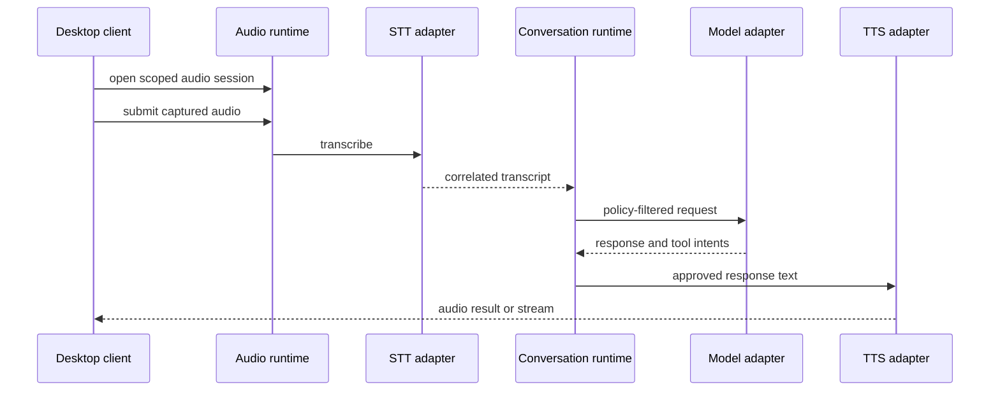

# Voice and Speech

## Scope and Status

The Voice, Audio and Speech backend is **Implemented / Frozen**. It includes
real audio ingestion, devices, STT, TTS, objective analysis, VAD, persistent
recordings/sessions/syntheses, Voice Message, Conversation Mode, barge-in,
retention, and a neutral Perception sink. Canonical details are documented in
`docs/backend/voice.md`, `docs/backend/audio.md`, `docs/backend/speech.md`, and
`docs/backend/voice-sessions.md`.

Voice is an adapter-driven modality. It does not bypass conversations, agent
policy, model routing, permissions, or audit.

## Runtime Boundaries

| Package | Responsibility | Status |
| --- | --- | --- |
| `synapse.audio` | devices, ingestion, normalization, input/output requests | Implemented / Frozen |
| `synapse.voice` | sessions, conversation orchestration, recordings, synthesis, settings | Implemented / Frozen |
| `synapse.speech_adapters` | STT/TTS/analysis adapter registry and execution | Implemented / Frozen |
| `synapse.speech_pipeline` | compatibility pipeline lifecycle | Implemented / Frozen |
| `synapse.multimodal` | correlation with other modality sessions | Implemented foundation |

`VoiceRuntime` coordinates voice state; it is not a second conversation
runtime. `AudioRuntime` owns audio transport contracts; it is not responsible
for choosing an agent response.

## Target Flow

Every turn carries session, correlation, and causation identifiers. The text
transcript becomes a normal conversation input. Tool calls still pass through
tool policy and approval gates before any spoken confirmation is produced.

## State Machines

Speech pipeline states are `idle`, `listening`, `processing`, `speaking`,
`paused`, `closed`, and `failed`. Voice utterances move through `pending`,
`synthesizing`, `ready`, `playing`, and a terminal state of `completed`,
`failed`, or `cancelled`.

Transitions must be validated, persisted when recovery requires it, and emit
events. A closed session is terminal. Failed provider work must not leave the
session permanently marked as speaking.

## Providers

Current provider records include deterministic `mock_stt` and `mock_tts`, local
`faster_whisper`, and local `piper`. Mock adapters are for tests and explicit
development mode only.

Faster Whisper models live under `DATA_DIR/voice/models/faster-whisper`. Piper
availability depends on its executable/model configuration. Discovery,
installation, readiness, and successful execution are distinct states; a
registered adapter must not be reported as ready solely because its manifest
exists.

Each adapter reports:

- provider and adapter identity;
- supported capability (`speech_to_text` or `text_to_speech`);
- enabled and health state;
- language, format, and model constraints where known;
- structured unavailability and execution failures;
- measured latency when available.

## Voice Selection

Voice owns factual voice states and events. Provider selection uses an explicit
request override when policy permits it, then the configured system default;
absence of a valid provider remains a visible configuration error.

Runtime code must not silently choose a cloud provider or transmit audio when a
local provider is unavailable.

Frontend owns visualization and animation. Perception owns multimodal
observations, features, and inferences. No Avatar or Embodiment Runtime exists
in the target architecture.

## Audio Contract

Input records identify format, sample properties, duration, device, and either
an approved local reference or request payload. Output records identify MIME
type, provider, voice, duration when known, and a bounded payload/reference.
Large or continuous audio must not be embedded indefinitely in JSON state.

The desktop client owns microphone capture and playback. The backend owns
provider execution, session state, policy, and event correlation. Device IDs
are machine-local and must never be treated as portable identity.

## Privacy and Security

- Microphone capture requires an explicit user-visible active state.
- Raw recordings are not retained by default after successful transcription.
- Retention, export, and diagnostic capture require explicit configuration.
- Logs contain metadata and failure codes, not raw audio or complete sensitive
  transcripts.
- Cloud speech providers, if added, require explicit configuration and consent.
- Audio references must resolve inside approved data/workspace roots.
- Model-generated speech is untrusted output and cannot authorize an action.

## Failure Semantics

Provider unavailable, invalid audio, transcription failure, synthesis failure,
timeout, cancellation, and session conflict are separate failures. Retrying an
input turn requires an idempotency key so the transcript is not appended twice.
Cancellation is cooperative and produces a terminal event.

Fallback between providers is **planned** and must be policy-driven. It cannot
silently change privacy class, cost class, language, or voice identity.

## Testing Requirements

Controlled provider fixtures cover state and orchestration without registering
production mocks. Adapter tests isolate external processes and model files.
Integration fixtures use generated short audio samples. Required regressions include invalid transitions,
duplicate turns, provider loss, cancellation, path rejection, profile
resolution, cleanup, and event correlation.

The domain is complete only when speech pipeline and adapter tests are green,
the global suite does not regress, real local STT/TTS readiness is truthful,
and the V3 desktop completes a capture-to-response-to-playback smoke test.
